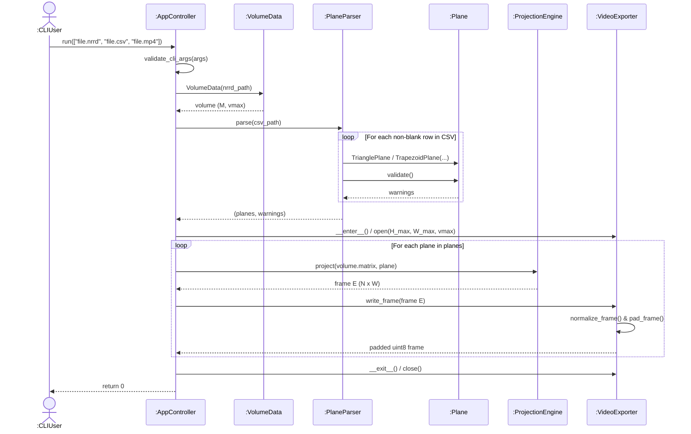
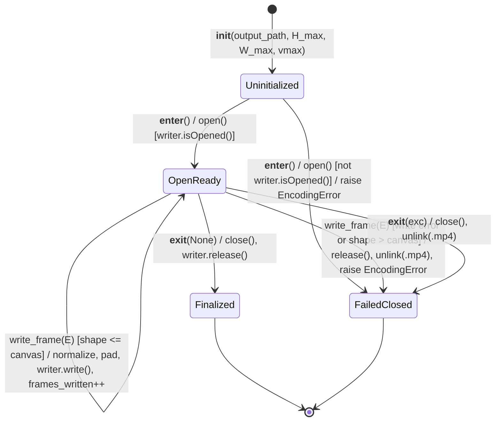

# Engineering Design Document (EDD)
**Project:** High-Performance 3D Volumetric Plane Projection (`Ex0.py`)

---

## 1. Module & Class Detailed Design

This document specifies the component-level engineering details, mathematical algorithms, data formats, sequence flows, state transitions, edge-case handling, performance budget, and component trade-offs that implement the architecture in [SDD.md](SDD.md) and satisfy [SRS.md](SRS.md).

### 1.1 `VolumeData` Memory & Axis Engineering (`src/volume_data.py`)
* **Fortran Axis Ordering (`index_order="F"`):** `nrrd.read(str(path), index_order="F")` is used so the first NRRD header axis maps directly to index `0` ($x$), the second to `1` ($y$), and the third to `2` ($z$), matching the `M[x, y, z]` specification (`FR-2`).
* **Contiguous Read-Only Buffer:** After validation and optional non-negative signed-to-unsigned casting (`int8->uint8`, `int16->uint16`, `int32->uint32`), `np.ascontiguousarray(validated)` ensures C-contiguous memory layout for fast cache-friendly voxel gather, and `matrix.flags.writeable = False` prevents accidental mutation.
* **O(1) Access to `vmax`:** `self._vmax = int(np.max(self._matrix))` is computed once in `__init__`.

### 1.2 `Plane` Hierarchy & Coplanarity Math (`src/plane.py`)
* **Immutability:** Both `TrianglePlane` and `TrapezoidPlane` use `@dataclass(frozen=True)` and convert input coordinate sequences via `_to_vec3()` into read-only `float64` arrays of shape `(3,)` after checking `np.all(np.isfinite(arr))`.
* **Triangle Collinearity Check:** `TrianglePlane._validate_shape_specific()` computes the cross-product magnitude $\|(b - a) \times (c - a)\|_2$. If $< 10^{-9}$ (`EPSILON`), it raises `PlaneError` (collinear points / zero area).
* **Trapezoid Coplanarity Check:** `TrapezoidPlane._validate_shape_specific()` computes the plane normal $\mathbf{n} = (b - a') \times (a'' - a')$ (falling back to $(b - a') \times (c - a')$ if the top base is near-zero). The orthogonal distance of the fourth point $c$ from the plane of $(a', b, a'')$ is:
  $$d_{\perp} = \frac{|(c - a') \cdot \mathbf{n}|}{\|\mathbf{n}\|_2}, \qquad \delta_{\text{cop}} = \frac{d_{\perp}}{D_{ab}}$$
  If $\delta_{\text{cop}} > 0.10$, `PlaneError` is raised; if $0.01 < \delta_{\text{cop}} \le 0.10$, a warning naming `row_index` is appended.

### 1.3 `VideoExporter` OpenCV Stream Engineering (`src/video_exporter.py`)
* **Dimension Ordering:** NumPy arrays have shape `(height, width) = (H_max, W_max)`, whereas `cv2.VideoWriter` expects `frameSize = (width, height) = (W_max, H_max)`.
* **3-Channel BGR Grayscale Conversion:** For universal cross-platform `mp4v` codec compatibility in OpenCV, each 2D `uint8` grayscale canvas `(H_max, W_max)` is converted via `cv2.cvtColor(padded, cv2.COLOR_GRAY2BGR)` immediately prior to `writer.write(bgr_frame)`.

### 1.4 Domain Exception Hierarchy (`src/exceptions.py`)
| Exception Class | Base Class | `exit_code` | Trigger Condition |
|---|---|---|---|
| `SlicerError` | `Exception` | `1` (default) | Common base class caught by `AppController.run()`. |
| `InputError` | `SlicerError` | `1` | Argument count $\ne 3$, bad extension, missing input file, unwritable output directory/file (`FR-1`). |
| `VolumeError` | `SlicerError` | `2` | Unreadable NRRD, `ndim != 3`, axis $\notin [1, 1023]$, negative values, or float dtype (`FR-2`). |
| `PlaneError` | `SlicerError` | `2` | Column count $\ne 13$, point count $\notin \{3, 4\}$, non-numeric cell, $\delta > 10\%$, or $N, W < 1$ (`FR-3`, `FR-4`). Stores `row_index`. |
| `EncodingError` | `SlicerError` | `3` | `cv2.VideoWriter` fails to open, frame write fails, or output MP4 is 0 bytes (`FR-9`). |

---

## 2. Detailed Projection Algorithm (`ProjectionEngine`)

This section fulfills **Assignment Ex1 To-Do #3 ("Define the main algorithm in detail")**, bridging the conceptual pseudocode on Page 2 of the assignment handout to the production vectorized implementation in `src/projection_engine.py`.

### 2.1 Analysis of the Assignment Reference Pseudocode (Ex1 Page 2)
Page 1 of the assignment notes: *"this problem is NOT well-defined for implementation - a detailed design is needed."* Page 2 provides the conceptual scanline pseudocode for a triangle $(a, b, c)$:
```text
1. Let Dab = dist(a,b) = dist(a,c). Let Dbc = dist(b,c).
2. Let v(a,b) = vector(a,b) / Dab, define v(a,c) accordingly.
3. Define an output 2D Matrix E of size Dab * Dbc
4. Let a1 = a, a2 = a
5. For (int y = 0; y < Dab; y++)
     a. a1 = a1 + v(ab)
     b. a2 = a2 + v(ac)
     c. p = a1
     d. d12 = dist(a1, a2)
     e. dp = vector(a1, a2) / d12
     f. for (int x1 = 0; x1 <= d12; x1++)
          i.   v = M[p]                    # if p is NOT in M, v = 0
          ii.  x = (Dbc / 2) - (d12 / 2) + x1
          iii. E[x][y] = v
          iv.  p = p + dp
6. Return E
```
Directly translating that pseudocode into code surfaces **six mathematical and implementation ambiguities**, each resolved below:

| Assignment Page 2 Step | Ambiguity in Raw Pseudocode | Engineering Resolution in `Plane` & `ProjectionEngine` |
|---|---|---|
| **Step 1 & 3:** `Dab * Dbc` matrix size | Euclidean distances $D_{ab}, D_{bc} \in \mathbb{R}$ are floating-point numbers, whereas matrix dimensions must be positive integers; for slightly unequal legs ($L_1 \ne L_2$) or trapezoids with two bases, which length governs? | Set $D_{ab} = \max(L_1, L_2)$ and $D_{bc} = \max(\|a''-a'\|_2, \|c-b\|_2)$, then round to nearest integers $N = \text{round}(D_{ab}) \ge 1$ and $W = \text{round}(D_{bc}) \ge 1$. |
| **Step 5a–5b:** `a1 += v(ab)`, `a2 += v(ac)` | When $L_1$ and $L_2$ differ by $1\%\text{–}10\%$ (e.g., Row 3 of `data/sample_planes.csv` has $\delta = 4.12\%$), stepping by unit vectors causes the shorter leg to overshoot its endpoint before row $N-1$. | Use parametric fractional stepping $t(y) = (y + 1)/N \in (0, 1]$ along both legs: $\mathbf{a}_1(y) = \mathbf{T}_L + t(y)(\mathbf{B}_L - \mathbf{T}_L)$ and $\mathbf{a}_2(y) = \mathbf{T}_R + t(y)(\mathbf{B}_R - \mathbf{T}_R)$. When $L_1 = L_2 = N$, this is identical to unit-vector stepping (`a1 + v(ab)`), while staying synchronized when $L_1 \ne L_2$. |
| **Step 5d–5e:** `dp = vector(a1,a2) / d12` | If $d_{12} = 0$ (e.g., at an unstepped apex), dividing by $d_{12}$ raises `ZeroDivisionError` / `NaN`. | Starting at $t = (y+1)/N \ge 1/N$ steps past the triangle apex on row $y=0$, and `np.divide(..., where=(d12 > 1e-9))` zeroes out $\mathbf{dp}$ if $d_{12} \le 10^{-9}$. |
| **Step 5f & 5f.ii:** `for x1=0; x1<=d12; x1++` and `x = (Dbc/2)-(d12/2)+x1` | $(W/2) - (d_{12}/2)$ is generally non-integer, and when $d_{12} = W$, `x1 = d12` yields $x = W$, which is **out of bounds** for a $0$-indexed array of width $W$ (`0..W-1`). | Invert the centering equation over valid integer columns $x \in \{0, 1, \dots, W-1\}$: $x_1(y, x) = x - (W - d_{12}(y))/2$, and apply boolean mask `0.0 <= x1 <= d12`. Column overflow is impossible. |
| **Step 5f.i:** `v = M[p]` | $\mathbf{p} \in \mathbb{R}^3$ is a continuous 3D point, whereas $M$ requires integer indices $(i_x, i_y, i_z)$. | Round each coordinate to the nearest integer via `np.rint(p).astype(np.intp)` before checking $0 \le i_x < sx$, $0 \le i_y < sy$, $0 \le i_z < sz$. |
| **Step 5f.iii:** `E[x][y] = v` | Indexing `E[x][y]` places horizontal column $x$ as the first index (transposing the image in row-major NumPy/OpenCV memory). | Store $E$ in standard image row-major order `E[row, col] = E[y, x]` of shape `(N, W)`. |

### 2.2 Unified Four-Corner Geometry
Every slicing plane is represented by four 3D corner vectors $(\mathbf{T}_L, \mathbf{T}_R, \mathbf{B}_L, \mathbf{B}_R) \in \mathbb{R}^3$:
* **Isosceles Triangle ($a, b, c$):**
  $$\mathbf{T}_L = a, \quad \mathbf{T}_R = a, \quad \mathbf{B}_L = b, \quad \mathbf{B}_R = c$$
  Leg lengths: $L_1 = \|b - a\|_2$, $L_2 = \|c - a\|_2$, $D_{ab} = \max(L_1, L_2)$. Base length: $D_{bc} = \|c - b\|_2$.
* **Isosceles Trapezoid ($a', b, a'', c$):**
  $$\mathbf{T}_L = a', \quad \mathbf{T}_R = a'', \quad \mathbf{B}_L = b, \quad \mathbf{B}_R = c$$
  Leg lengths: $L_1 = \|b - a'\|_2$, $L_2 = \|c - a''\|_2$, $D_{ab} = \max(L_1, L_2)$. Base length: $D_{bc} = \max(\|a'' - a'\|_2, \|c - b\|_2)$.
* **Discrete Output Dimensions:** The 2D output matrix $E$ has height $N = \text{round}(D_{ab})$ rows and width $W = \text{round}(D_{bc})$ columns, stored as `E[row, col]` (`row = y` $\in [0, N-1]$, `col = x` $\in [0, W-1]$) and initialized to `0`.

### 2.3 Conceptual Scanline Formulation
In the sequential scanline model, each row $y \in \{0, 1, \dots, N - 1\}$ steps down both legs simultaneously and sweeps a horizontal scanline from the left leg point $\mathbf{a}_1(y)$ to the right leg point $\mathbf{a}_2(y)$:
1. **Fractional Step Along Both Legs:**
   $$t(y) = \frac{y + 1}{N} \quad \text{for } y = 0, 1, \dots, N - 1 \quad \big(t \in (0, 1]\big)$$
2. **Scanline Endpoints:**
   $$\mathbf{a}_1(y) = \mathbf{T}_L + t(y)(\mathbf{B}_L - \mathbf{T}_L), \qquad \mathbf{a}_2(y) = \mathbf{T}_R + t(y)(\mathbf{B}_R - \mathbf{T}_R)$$
3. **Scanline Length & Unit Direction Vector:**
   $$d_{12}(y) = \|\mathbf{a}_2(y) - \mathbf{a}_1(y)\|_2, \qquad \mathbf{dp}(y) = \begin{cases} \dfrac{\mathbf{a}_2(y) - \mathbf{a}_1(y)}{d_{12}(y)} & \text{if } d_{12}(y) > 10^{-9} \\ \mathbf{0} & \text{otherwise} \end{cases}$$
4. **Centered Horizontal Sweep:** For a step offset $x_1 \in [0, d_{12}(y)]$ along the scanline, the 3D sample point and centered column index are:
   $$\mathbf{p}(y, x_1) = \mathbf{a}_1(y) + x_1\,\mathbf{dp}(y), \qquad x = \frac{W}{2} - \frac{d_{12}(y)}{2} + x_1$$
   Inverting the centering relation for each integer column $x \in \{0, 1, \dots, W - 1\}$ gives:
   $$x_1(y, x) = x - \frac{W - d_{12}(y)}{2}$$
   A column $x$ on row $y$ lies inside the triangle/trapezoid if and only if $0 \le x_1(y, x) \le d_{12}(y)$.

### 2.4 Vectorized `NumPy` Implementation (`src/projection_engine.py`)
To achieve $\ge 100\text{ FPS}$ on $500^3$ volumes (`NFR-1`), `ProjectionEngine.project(volume, plane)` executes the entire projection in five vectorized array operations with zero Python loops:
1. **1D Row Arrays (shape `(N, 1)` and `(N, 3)`):**
   ```python
   y   = np.arange(n_rows, dtype=np.float64)[:, None]                # (N, 1)
   t   = (y + 1.0) / n_rows                                          # (N, 1)
   a1  = t_l[None, :] + t * (b_l - t_l)[None, :]                     # (N, 3)
   a2  = t_r[None, :] + t * (b_r - t_r)[None, :]                     # (N, 3)
   vec = a2 - a1                                                     # (N, 3)
   d12 = np.linalg.norm(vec, axis=1, keepdims=True)                  # (N, 1)
   dp  = np.divide(vec, d12, out=np.zeros_like(vec), where=(d12 > EPSILON))
   ```
2. **2D Scanline Offset & Shape Mask (shape `(N, W)`):**
   ```python
   x          = np.arange(n_cols, dtype=np.float64)[None, :]         # (1, W)
   x1         = x - (n_cols - d12) / 2.0                             # (N, W)
   mask_shape = (x1 >= 0.0) & (x1 <= d12)                            # (N, W) bool
   ```
3. **3D Sample Coordinates & Nearest-Neighbor Rounding (shape `(N, W)`):**
   ```python
   ix = np.rint(a1[:, 0:1] + x1 * dp[:, 0:1]).astype(np.intp)
   iy = np.rint(a1[:, 1:2] + x1 * dp[:, 1:2]).astype(np.intp)
   iz = np.rint(a1[:, 2:3] + x1 * dp[:, 2:3]).astype(np.intp)
   ```
4. **Volume Boundary Mask (shape `(N, W)`):**
   ```python
   mask_vol = (ix >= 0) & (ix < sx) & (iy >= 0) & (iy < sy) & (iz >= 0) & (iz < sz)
   valid    = mask_shape & mask_vol                                  # (N, W) bool
   ```
5. **Single-Pass Masked Voxel Gather (shape `(N, W)`):**
   ```python
   frame = np.zeros((n_rows, n_cols), dtype=volume.dtype)
   frame[valid] = volume[ix[valid], iy[valid], iz[valid]]
   return frame
   ```

---

## 3. Data Formats & Memory Layout

* **13-Column CSV Schema (`data/sample_planes.csv` Convention):**
  | Col 0 | Cols 1–3 | Cols 4–6 | Cols 7–9 | Cols 10–12 |
  |---|---|---|---|---|
  | `3` (Triangle) | $a = (x_1, y_1, z_1)$ | $b = (x_2, y_2, z_2)$ | $c = (x_3, y_3, z_3)$ | Empty (`""`) |
  | `4` (Trapezoid) | $a' = (x_1, y_1, z_1)$ | $b = (x_2, y_2, z_2)$ | $a'' = (x_3, y_3, z_3)$ | $c = (x_4, y_4, z_4)$ |
  *Note on 4-point column order:* In the classroom dataset [`data/sample_planes.csv`](../data/sample_planes.csv), the four points are ordered $(a', b, a'', c)$ so that the first two triples define leg 1 ($a' \to b$) and the last two triples define leg 2 ($a'' \to c$), matching Ex1 Page 2 (*"two vectors on the same plane with the same length: $a' \to b$ and $a'' \to c$"*).
* **Centered Canvas Padding Offsets (`VideoExporter.pad_frame`):**
  $$\text{row\_offset} = \left\lfloor \frac{H_{\max} - N}{2} \right\rfloor, \qquad \text{col\_offset} = \left\lfloor \frac{W_{\max} - W}{2} \right\rfloor$$

---

## 4. Key Execution Flows (UML Sequence & State Machine Diagrams)

### 4.1 Three-Phase Pipeline & UML Sequence Diagram
1. **Phase 1 (Initialization, Ingestion & Up-Front Validation):** Validate CLI paths → Load `VolumeData` ($M$, `vmax`) → Parse & validate all `Plane` objects via `PlaneParser` → Emit warnings to `stderr` → Compute $(H_{\max}, W_{\max})$ → Open `VideoExporter`.
2. **Phase 2 (Transformation Loop):** For each `Plane`, call `ProjectionEngine.project(M, plane)` → Pass $E$ to `VideoExporter.write_frame(E)` → `del frame` to keep memory $O(1)$.
3. **Phase 3 (Finalization & Cleanup):** Close `VideoExporter` context manager → Verify non-empty `.mp4` on disk → Map any caught `SlicerError` to its `exit_code`.



### 4.2 UML State Machine: Life of a `VideoExporter` Stream Object
Following the UML state machine notation (states of a single object and the `event [guard] / action` transitions between them):



---

## 5. Error Handling & Resolved Algorithmic Edge Cases

| Edge Case | Engineering Resolution in `Plane` & `ProjectionEngine` |
|---|---|
| **Apex division by zero ($d_{12} = 0$)** | $t = (y + 1) / N$ steps past the apex on row 0 ($t \in (0, 1]$), and `np.divide(..., where=(d12 > 1e-9))` safely outputs $\mathbf{0}$ for any near-zero scanline. |
| **Column off-by-one ($x == W$)** | Evaluating $x_1(y, x)$ directly over integer columns $x \in [0, W - 1]$ and masking with $(x_1 \ge 0) \land (x_1 \le d_{12})$ makes column index overflow impossible. |
| **Slight leg-length mismatch ($1\%\text{–}10\%$)** | Parametric fraction $t \in (0, 1]$ synchronizes both legs from top to bottom so both endpoints reach $b$ and $c$ together on row $N-1$, while remaining identical to unit-step marching when $L_1 = L_2$. |
| **Continuous 3D point vs. discrete voxel** | `np.rint(...).astype(np.intp)` rounds to nearest integer indices before applying `mask_vol` (`FR-5`, `FR-6`). |
| **Pixels outside shape or outside volume** | `frame` is zero-initialized (`np.zeros`) and populated only where `valid = mask_shape & mask_vol` is `True`. |
| **All-zero volume ($v_{\max} = 0$)** | `VideoExporter.normalize_frame` guards `if vmax <= 0: return np.zeros(...)`, preventing `ZeroDivisionError` (`FR-8`). |

---

## 6. Configuration & Performance Budget

For a $500 \times 500 \times 500$ `uint8` volume ($125\text{ MB}$) and $500 \times 500$ frames ($250,000$ pixels/frame), `NFR-1` sets a mandatory ceiling of $\le 33.3\text{ ms/frame}$ ($\ge 30\text{ FPS}$) and a target budget of $\le 10.0\text{ ms/frame}$ ($\ge 100\text{ FPS}$):

| Operation Stage in `ProjectionEngine.project` | Transient Memory Allocation | Target Latency Budget (`NFR-1`) |
|---|---|---|
| **Step 1: 1D Row Setup (`y, t, a1, a2, d12, dp`)** | $\sim 24\text{ KB}$ (`(500, 3)` `float64`) | $\le 0.2\text{ ms}$ |
| **Step 2: 2D Scanline Offset & `mask_shape`** | $\sim 2.25\text{ MB}$ (`(500, 500)` `float64` + `bool`) | $\le 1.3\text{ ms}$ |
| **Step 3: 3D Coordinate Broadcast & `np.rint`** | $3 \times 2\text{ MB} = 6.0\text{ MB}$ (`ix, iy, iz` `intp`) | $\le 4.0\text{ ms}$ |
| **Step 4: Volume Boundary Mask (`mask_vol & valid`)** | $\sim 0.5\text{ MB}$ (`(500, 500)` `bool`) | $\le 1.0\text{ ms}$ |
| **Step 5: Masked Voxel Gather (`M[ix[valid], ...]`)** | $0.25\text{ MB}$ (`frame E` `uint8`) | $\le 3.5\text{ ms}$ |
| **Total Pure Projection (`ProjectionEngine`)** | **$O(1)$ across frames ($\sim 9\text{ MB}$ peak per frame)** | **Budget: $\le 10.0\text{ ms}$ ($\ge 100\text{ FPS}$)<br/>Measured: $2.30\text{ ms}$ ($435.3\text{ FPS}$, [EXPERIMENT.md](../results/EXPERIMENT.md))** |

---

## 7. Component-Level Alternatives & Trade-Offs

1. **Masked Fancy Indexing (`M[ix[valid], iy[valid], iz[valid]]`) vs. `np.clip` + Post-Gather Zeroing:**
   * *Alternative:* Clip all $(i_x, i_y, i_z)$ coordinates to $[0, s-1]$, gather all $N \times W$ pixels unconditionally, and zero out invalid pixels afterward (`frame[~valid] = 0`).
   * *Trade-off:* When a slicing plane lies partially outside the volume or is a triangle (where $50\%$ of the $N \times W$ bounding box lies outside the triangle footprint), masked indexing gathers **only** the valid inside-triangle, inside-volume voxels ($\le 50\%$ of the bounding box for triangles), cutting random 3D RAM reads in half.
2. **Fortran Order Load (`index_order="F"`) vs. Default C-Order + `np.transpose`:**
   * *Decision:* Loading directly with `nrrd.read(..., index_order="F")` followed by `np.ascontiguousarray()` establishes a contiguous $(sx, sy, sz)$ layout once at load time (`VolumeData.__init__`), avoiding view-stride penalties during every frame's 3D voxel lookup.

---

## 8. Component Testing & Rollout Plan

* **Isolated Unit Verification:** Every component in §§1–2 is verified independently before integration using synthetic analytical volumes in `tests/` (see [STP.md](STP.md) `TC-01`–`TC-11`).
* **Sequential Equivalence Gate:** `ProjectionEngine.project()` is verified pixel-for-pixel against the sequential loop formulation (`_sequential_reference_project` in `tests/test_projection_engine.py`, `TC-08`) before running performance benchmarks (`TC-15`).
* **Containerized Reproducibility:** Final rollout and benchmarking execute inside the locked Docker image (`python:3.11-slim`) via `python -m src.run_experiment`, producing `results/demo_output.mp4` and [../results/EXPERIMENT.md](../results/EXPERIMENT.md).
