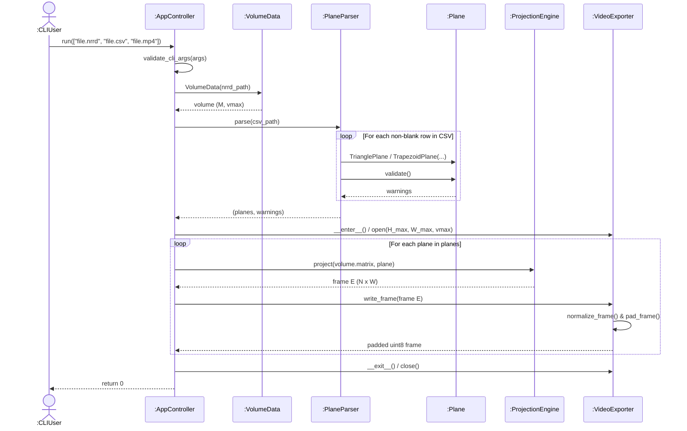
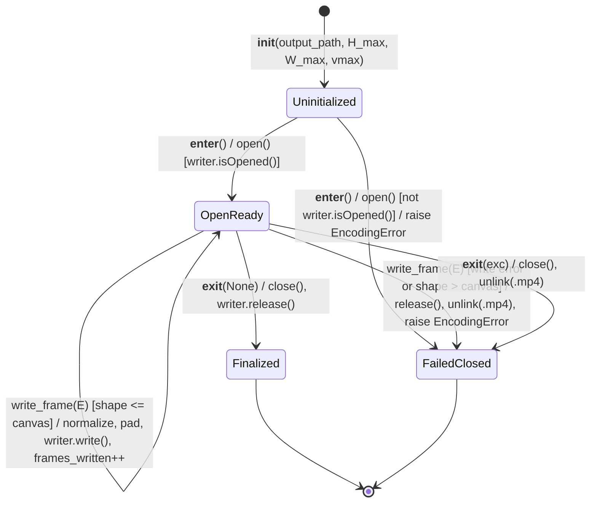

# Engineering Design Document (EDD)
**Project:** High-Performance 3D Volumetric Plane Projection (`Ex0.py`)

---

## 1. Module & Class Detailed Design

This document explains **how each module and function works under the hood**—including exact inputs, actions, outputs, mathematical formulas, and edge-case protections—implementing the architecture in [SDD.md](SDD.md) to satisfy [SRS.md](SRS.md).

### 1.1 `VolumeData` Memory & Axis Engineering (`src/volume_data.py`)

**Key Engineering Details:**
* **Direct `(x, y, z)` Axis Ordering (`index_order="F"`):** Calls `nrrd.read(str(path), index_order="F")` so the first NRRD axis maps directly to `x`, the second to `y`, and the third to `z` in `M[x, y, z]` (`FR-2`).
* **Fast, Read-Only Memory:** Converts valid non-negative signed scans (`int8`/`int16`/`int32`) to unsigned (`uint8`/`uint16`/`uint32`), packs the array contiguously in RAM (`np.ascontiguousarray`) for fast voxel lookups, and sets `matrix.flags.writeable = False` so nothing can accidentally modify the 3D scan.
* **One-Time `vmax` Calculation:** Precomputes `self._vmax = int(np.max(self._matrix))` once during loading so brightness scaling is instant later (`FR-8`).

**Function-by-Function Breakdown:**
* `VolumeData.__init__(file_path)`
  * **In:** Path to the `.nrrd` file (`str | Path`).
  * **Does:** Calls `_load_nrrd` and `_validate_matrix`, locks the 3D array as contiguous and read-only, and saves the global max brightness `vmax`.
  * **Out:** Initialized `VolumeData` object exposing `.matrix`, `.shape`, `.dtype`, and `.vmax`.
* `VolumeData._load_nrrd(path)`
  * **In:** `Path` to `.nrrd` file.
  * **Does:** Reads the NRRD raster from disk with `(x, y, z)` axis ordering.
  * **Out:** Raw `np.ndarray` (or raises `VolumeError` if unreadable).
* `VolumeData._validate_matrix(matrix)`
  * **In:** Raw `np.ndarray`.
  * **Does:** Checks that the array is 3D, every axis is between `1` and `1023`, and values are unsigned integers (`uint8`, `uint16`, `uint32`) or non-negative signed integers (which it promotes to unsigned).
  * **Out:** Validated unsigned `np.ndarray` (or raises `VolumeError`).

---

### 1.2 `Plane` Hierarchy & `PlaneParser` (`src/plane.py`, `src/plane_parser.py`)

**Key Engineering Details:**
* **Immutable Points:** `TrianglePlane` and `TrapezoidPlane` are frozen dataclasses (`@dataclass(frozen=True)`) that convert every 3D point via `_to_vec3()` into a read-only `float64` array of shape `(3,)`.
* **Triangle Collinearity Check:** `TrianglePlane._validate_shape_specific()` checks that the 3 points don't lie on a single straight line (zero area) by testing the cross-product length $\|(b - a) \times (c - a)\|_2 < 10^{-9}$ (`EPSILON`).
* **Trapezoid Flatness (Coplanarity) Check:** `TrapezoidPlane._validate_shape_specific()` ensures all 4 points lie on the same flat plane. It finds the normal vector $\mathbf{n} = (b - a') \times (a'' - a')$ of the first three points (falling back to $(b - a') \times (c - a')$ if the top edge is near-zero) and measures how far the 4th point $c$ sticks out from that plane relative to leg length $D_{ab}$:
  $$d_{\perp} = \frac{|(c - a') \cdot \mathbf{n}|}{\|\mathbf{n}\|_2}, \qquad \delta_{\text{cop}} = \frac{d_{\perp}}{D_{ab}}$$
  * $\delta_{\text{cop}} \le 1\%$: accepted silently.
  * $1\% < \delta_{\text{cop}} \le 10\%$: appends a warning naming `row_index`.
  * $\delta_{\text{cop}} > 10\%$: aborts with `PlaneError`.

**Function-by-Function Breakdown (`PlaneParser`):**
* `PlaneParser.parse(csv_path)`
  * **In:** Path to the `.csv` file.
  * **Does:** Reads all rows, skips blank lines and an optional text header on the first non-blank line, converts each row into a `Plane` via `_parse_row`, and validates its geometry via `plane.validate()`.
  * **Out:** Tuple `(planes, warnings)` — ordered `list[Plane]` and `list[str]` of warnings (or raises `PlaneError` if the file is empty or any row is invalid).
* `PlaneParser._parse_row(row, row_index)`
  * **In:** A 13-cell `list[str]` and its 1-based line number.
  * **Does:** Checks for 13 columns, reads column 1 (`3` or `4`), parses the coordinate cells via `_parse_floats`, and builds a `TrianglePlane` (if `3`, requiring columns 11–13 to be empty) or `TrapezoidPlane` (if `4`).
  * **Out:** `TrianglePlane` or `TrapezoidPlane`.
* `PlaneParser._is_numeric(text)` / `PlaneParser._parse_floats(cells, row_index, expected_count)`
  * **In:** Cell string(s) from a CSV row.
  * **Does:** `_is_numeric` checks whether the first row's first cell is a number or a header label; `_parse_floats` converts 9 or 12 coordinate strings into floats (raising `PlaneError` on blank or non-numeric cells).
  * **Out:** `bool` / `list[float]`.

**Function-by-Function Breakdown (`Plane`):**
* `_to_vec3(coords, row_index)`
  * **In:** 3-number coordinate sequence `(x, y, z)` and row number.
  * **Does:** Verifies 3 finite real numbers and locks the vector as read-only.
  * **Out:** Read-only `float64` `np.ndarray` of shape `(3,)`.
* `Plane` Geometry Properties (`top_left`, `top_right`, `bottom_left`, `bottom_right`, `left_leg_length`, `right_leg_length`, `d_ab`, `d_bc`, `height`, `width`)
  * **In:** The `Plane` instance.
  * **Does:** Maps corners (`top_left = top_right = a` for triangles; `a'` and `a''` for trapezoids), computes Euclidean leg/base lengths, and rounds pixel height $N = \text{round}(D_{ab})$ and width $W = \text{round}(D_{bc})$.
  * **Out:** Corner `np.ndarray` vectors, `float` lengths, and `int` pixel dimensions.
* `Plane.validate()` & `_validate_shape_specific(warnings)`
  * **In:** The `Plane` instance.
  * **Does:** Verifies `height >= 1` and `width >= 1`, checks that left/right leg difference $\delta = |L_1 - L_2| / \max(L_1, L_2)$ is within the $\le 1\%$ silent / $1\text{–}10\%$ warning / $> 10\%$ error thresholds, and runs triangle collinearity or trapezoid coplanarity checks.
  * **Out:** `list[str]` of warnings for that row (or raises `PlaneError`).

---

### 1.3 `VideoExporter` OpenCV Stream Engineering (`src/video_exporter.py`)

**Key Engineering Details:**
* **Width vs. Height Ordering:** NumPy arrays use `(rows, cols) = (H_max, W_max)`, whereas OpenCV's `cv2.VideoWriter` expects `(width, height) = (W_max, H_max)`. `VideoExporter.open()` swaps the tuple order for OpenCV automatically.
* **3-Channel BGR Grayscale Conversion:** Many media players fail on single-channel `mp4v` streams, so `write_frame()` converts each 2D `uint8` grayscale canvas into 3 identical channels via `cv2.cvtColor(padded, cv2.COLOR_GRAY2BGR)` right before encoding.

**Function-by-Function Breakdown:**
* `VideoExporter.normalize_frame(frame, vmax)`
  * **In:** Raw 2D `frame` (`uint8`/`uint16`/`uint32`) and global volume max `vmax`.
  * **Does:** Leaves `uint8` untouched; scales `uint16`/`uint32` into `0..255` via `round(frame * 255 / vmax)` (returns all zeros if `vmax <= 0`).
  * **Out:** 2D `uint8` grayscale array.
* `VideoExporter.pad_frame(frame, canvas_height, canvas_width)`
  * **In:** 2D `uint8` `frame` of shape `(N, W)` and target video dimensions `(H_max, W_max)`.
  * **Does:** Places the frame in the exact center of a black (`0`) `H_max x W_max` canvas so every frame in the video has the exact same resolution.
  * **Out:** Centered 2D `uint8` array of shape `(H_max, W_max)`.
* `VideoExporter.open()` / `close()` (managed via `with VideoExporter(...)`: `__enter__` / `__exit__`)
  * **In / Out:** None.
  * **Does:** Opens and closes the 30 FPS `mp4v` `cv2.VideoWriter` stream. If an exception happens inside the `with` block, `__exit__` closes the handle and deletes any half-written `.mp4` file from disk.
* `VideoExporter.write_frame(frame)`
  * **In:** Raw 2D slice `frame` from `ProjectionEngine.project()`.
  * **Does:** Calls `normalize_frame` → calls `pad_frame` → converts to 3-channel BGR → writes the frame to the `.mp4` stream and increments `frames_written`.
  * **Out:** The padded 2D `uint8` canvas frame `(H_max, W_max)` that was written.

---

### 1.4 `AppController` & Domain Exception Hierarchy (`Ex0.py`, `src/app_controller.py`, `src/exceptions.py`)

**Function-by-Function Breakdown:**
* `Ex0.main(argv)`
  * **In:** Optional list of CLI argument strings (defaults to `sys.argv[1:]`).
  * **Does:** Instantiates `AppController` and calls `run(args)`.
  * **Out:** CLI exit code (`0`, `1`, `2`, or `3`).
* `AppController.validate_cli_args(args)`
  * **In:** Sequence of CLI strings.
  * **Does:** Checks that exactly 3 arguments were passed with `.nrrd`, `.csv`, and `.mp4` extensions, both input files exist, and the output directory/file is writable.
  * **Out:** Tuple `(nrrd_path, csv_path, mp4_path)` as `Path` objects (or raises `InputError`).
* `AppController.run(args)`
  * **In:** Sequence of CLI strings.
  * **Does:** Coordinates Phases 1–3: validates CLI args → loads `VolumeData` → parses `Plane`s & prints warnings to `stderr` → finds max canvas `(H_max, W_max)` → opens `VideoExporter` and streams `engine.project()` frames one by one → catches any `SlicerError` and prints `"Error: ..."` cleanly without a Python traceback.
  * **Out:** Exit code (`0` = success, `1` = input/unexpected error, `2` = bad NRRD/CSV data, `3` = video encoding error).

**Domain Exception Table (`src/exceptions.py`):**

| Exception Class | Base Class | `exit_code` | When It Is Raised |
|---|---|---|---|
| `SlicerError` | `Exception` | `1` (default) | Base class for all expected application errors; caught by `AppController.run()`. |
| `InputError` | `SlicerError` | `1` | Wrong argument count, wrong file extension, missing input file, or unwritable output path (`FR-1`). |
| `VolumeError` | `SlicerError` | `2` | Corrupt NRRD, not 3D, axis size outside `1..1023`, negative voxels, or float data type (`FR-2`). |
| `PlaneError` | `SlicerError` | `2` | Bad CSV column/point count, non-numeric cell, geometry mismatch $> 10\%$, or size $< 1$ pixel (`FR-3`, `FR-4`). Prefixes message with `Row <row_index>:`. |
| `EncodingError` | `SlicerError` | `3` | OpenCV `VideoWriter` fails to open/write, frame count mismatches, or output `.mp4` is empty (`FR-9`). |

---

## 2. Detailed Projection Algorithm (`ProjectionEngine`)

This section fulfills **Assignment Ex1 To-Do #3 ("Define the main algorithm in detail")**, showing both the plain-English intuition and how the conceptual pseudocode on Page 2 of the assignment is turned into fast, bug-free NumPy code in `src/projection_engine.py`.

**Plain-English Overview of `ProjectionEngine.project(volume, plane)`:**
* **In:** Read-only 3D `volume` array `M[x, y, z]` and one validated `Plane` (`TrianglePlane` or `TrapezoidPlane`).
* **Does (in 5 vectorized steps, zero Python loops):**
  1. Steps evenly down the left and right legs of the shape to find the 3D start (`a1`) and end (`a2`) of every horizontal row (scanline).
  2. Centers each scanline horizontally inside the 2D `(height, width)` rectangle and creates `mask_shape` to mark which pixels actually fall inside the triangle/trapezoid.
  3. Calculates each pixel's exact 3D position along its scanline and rounds `(x, y, z)` to the nearest whole voxel index `(ix, iy, iz)`.
  4. Creates `mask_vol` to mark which rounded coordinates fall safely inside the 3D scan's boundaries (`0 <= i < size`).
  5. Copies voxel brightness values from `volume` into a black (`0`) 2D image only where `valid = mask_shape & mask_vol` is `True`.
* **Out:** 2D `np.ndarray` slice `E` of shape `(plane.height, plane.width)` with the same integer dtype as `volume`.

### 2.1 Analysis of the Assignment Reference Pseudocode (Ex1 Page 2)
Page 1 of the assignment notes: *"this problem is NOT well-defined for implementation - a detailed design is needed."* Page 2 gives this conceptual loop for a triangle $(a, b, c)$:
```text
1. Let Dab = dist(a,b) = dist(a,c). Let Dbc = dist(b,c).
2. Let v(a,b) = vector(a,b) / Dab, define v(a,c) accordingly.
3. Define an output 2D Matrix E of size Dab * Dbc
4. Let a1 = a, a2 = a
5. For (int y = 0; y < Dab; y++)
     a. a1 = a1 + v(ab)
     b. a2 = a2 + v(ac)
     c. p = a1
     d. d12 = dist(a1, a2)
     e. dp = vector(a1, a2) / d12
     f. for (int x1 = 0; x1 <= d12; x1++)
          i.   v = M[p]                    # if p is NOT in M, v = 0
          ii.  x = (Dbc / 2) - (d12 / 2) + x1
          iii. E[x][y] = v
          iv.  p = p + dp
6. Return E
```
Coding that pseudocode literally causes **six edge-case bugs/ambiguities**. Here is how our design resolves each one:

| Assignment Page 2 Step | Problem in Raw Pseudocode | How `Plane` & `ProjectionEngine` Fix It |
|---|---|---|
| **Step 1 & 3:** `Dab * Dbc` array size | 3D distances $D_{ab}, D_{bc}$ are decimals, not whole pixel counts—and what if the two legs differ slightly or a trapezoid has two bases? | Take the longer leg $D_{ab} = \max(L_1, L_2)$ and wider base $D_{bc} = \max(\|a''-a'\|_2, \|c-b\|_2)$, then round to whole pixels: $N = \text{round}(D_{ab}) \ge 1$, $W = \text{round}(D_{bc}) \ge 1$. |
| **Step 5a–5b:** `a1 += v(ab)`, `a2 += v(ac)` | If legs $L_1$ and $L_2$ differ by $1\%\text{–}10\%$ (e.g., Row 3 of `sample_planes.csv` differs by $4.12\%$), stepping 1 voxel at a time makes the shorter leg pass its corner too early. | Step by fraction $t(y) = (y + 1)/N \in (0, 1]$ down both legs together: $\mathbf{a}_1(y) = \mathbf{T}_L + t(y)(\mathbf{B}_L - \mathbf{T}_L)$ and $\mathbf{a}_2(y) = \mathbf{T}_R + t(y)(\mathbf{B}_R - \mathbf{T}_R)$. Both legs reach the bottom together, and when $L_1 = L_2 = N$ it matches unit-stepping. |
| **Step 5d–5e:** `dp = vector(a1,a2) / d12` | If scanline width $d_{12} = 0$ (at a triangle's tip), dividing by $d_{12}$ crashes with `ZeroDivisionError` / `NaN`. | Starting at $t = (y+1)/N \ge 1/N$ steps just past the tip on row $0$, and `np.divide(..., where=(d12 > 1e-9))` safely sets $\mathbf{dp} = \mathbf{0}$ whenever $d_{12} \le 10^{-9}$. |
| **Step 5f & 5f.ii:** `x1 <= d12` and `x = (Dbc/2)-(d12/2)+x1` | $(W - d_{12})/2$ can be a half-pixel (`.5`), and when $d_{12} = W$, `x1 = d12` gives column $x = W$, crashing a `0..W-1` array with `IndexError`. | Flip the formula: loop over valid integer columns $x \in \{0, \dots, W-1\}$, compute $x_1 = x - (W - d_{12})/2$, and keep pixels where `0.0 <= x1 <= d12`. Column overflow is impossible. |
| **Step 5f.i:** `v = M[p]` | 3D point $\mathbf{p}$ has decimal coordinates, whereas array `M` needs integer indices. | Round to nearest integer indices via `np.rint(p).astype(np.intp)` before checking volume bounds. |
| **Step 5f.iii:** `E[x][y] = v` | Writing `E[x][y]` puts horizontal column `x` first, rotating/transposing the video frame sideways in NumPy/OpenCV. | Store images in standard `(row, col)` order: `E[y, x]` of shape `(N, W)`. |

### 2.2 Unified Four-Corner Geometry
Every plane exposes four 3D corner vectors $(\mathbf{T}_L, \mathbf{T}_R, \mathbf{B}_L, \mathbf{B}_R) \in \mathbb{R}^3$:
* **Isosceles Triangle ($a, b, c$):** Top-left and top-right are both the apex $a$:
  $$\mathbf{T}_L = a, \quad \mathbf{T}_R = a, \quad \mathbf{B}_L = b, \quad \mathbf{B}_R = c$$
  Leg lengths: $L_1 = \|b - a\|_2$, $L_2 = \|c - a\|_2$, $D_{ab} = \max(L_1, L_2)$. Base width: $D_{bc} = \|c - b\|_2$.
* **Isosceles Trapezoid ($a', b, a'', c$):**
  $$\mathbf{T}_L = a', \quad \mathbf{T}_R = a'', \quad \mathbf{B}_L = b, \quad \mathbf{B}_R = c$$
  Leg lengths: $L_1 = \|b - a'\|_2$, $L_2 = \|c - a''\|_2$, $D_{ab} = \max(L_1, L_2)$. Base width: $D_{bc} = \max(\|a'' - a'\|_2, \|c - b\|_2)$.
* **Output Image Grid:** 2D array $E$ has height $N = \text{round}(D_{ab})$ rows and width $W = \text{round}(D_{bc})$ columns, indexed `E[y, x]` and initialized to `0`.

### 2.3 Conceptual Scanline Formulation
For each horizontal row $y \in \{0, 1, \dots, N - 1\}$ from top to bottom:
1. **Fraction Down Both Legs:**
   $$t(y) = \frac{y + 1}{N} \quad \text{for } y = 0, 1, \dots, N - 1 \quad \big(t \in (0, 1]\big)$$
2. **Left & Right Scanline Endpoints in 3D:**
   $$\mathbf{a}_1(y) = \mathbf{T}_L + t(y)(\mathbf{B}_L - \mathbf{T}_L), \qquad \mathbf{a}_2(y) = \mathbf{T}_R + t(y)(\mathbf{B}_R - \mathbf{T}_R)$$
3. **Scanline Width & Unit Step Vector ($\mathbf{a}_1 \to \mathbf{a}_2$):**
   $$d_{12}(y) = \|\mathbf{a}_2(y) - \mathbf{a}_1(y)\|_2, \qquad \mathbf{dp}(y) = \begin{cases} \dfrac{\mathbf{a}_2(y) - \mathbf{a}_1(y)}{d_{12}(y)} & \text{if } d_{12}(y) > 10^{-9} \\ \mathbf{0} & \text{otherwise} \end{cases}$$
4. **Horizontal Centering Across Columns $x \in \{0, \dots, W-1\}$:**
   A step $x_1 \in [0, d_{12}(y)]$ along the scanline lands at 3D point $\mathbf{p}(y, x_1) = \mathbf{a}_1(y) + x_1\,\mathbf{dp}(y)$ and centered image column $x = \frac{W}{2} - \frac{d_{12}(y)}{2} + x_1$. Solving for $x_1$ at each integer pixel column $x$ gives:
   $$x_1(y, x) = x - \frac{W - d_{12}(y)}{2}$$
   Pixel $(y, x)$ is inside the shape whenever $0 \le x_1(y, x) \le d_{12}(y)$.

### 2.4 Vectorized `NumPy` Implementation (`src/projection_engine.py`)
Instead of looping over rows and columns in Python, `ProjectionEngine.project(volume, plane)` computes all $N \times W$ pixels at once in five array steps:

1. **Step 1 — Compute all $N$ scanline start/end points and unit directions at once (`(N, 1)` and `(N, 3)`):**
   ```python
   y   = np.arange(n_rows, dtype=np.float64)[:, None]                # Row indices 0..N-1
   t   = (y + 1.0) / n_rows                                          # Fractional progress (0, 1]
   a1  = t_l[None, :] + t * (b_l - t_l)[None, :]                     # Left leg 3D points per row
   a2  = t_r[None, :] + t * (b_r - t_r)[None, :]                     # Right leg 3D points per row
   vec = a2 - a1                                                     # Scanline vectors a1 -> a2
   d12 = np.linalg.norm(vec, axis=1, keepdims=True)                  # Scanline widths per row
   dp  = np.divide(vec, d12, out=np.zeros_like(vec), where=(d12 > EPSILON))
   ```
2. **Step 2 — Find horizontal scanline offsets for all $(N, W)$ pixels and mask the shape footprint:**
   ```python
   x          = np.arange(n_cols, dtype=np.float64)[None, :]         # Column indices 0..W-1
   x1         = x - (n_cols - d12) / 2.0                             # Offset along each row's scanline
   mask_shape = (x1 >= 0.0) & (x1 <= d12)                            # True only inside triangle/trapezoid
   ```
3. **Step 3 — Broadcast 3D sample positions and round to nearest integer voxel indices `(ix, iy, iz)`:**
   ```python
   ix = np.rint(a1[:, 0:1] + x1 * dp[:, 0:1]).astype(np.intp)
   iy = np.rint(a1[:, 1:2] + x1 * dp[:, 1:2]).astype(np.intp)
   iz = np.rint(a1[:, 2:3] + x1 * dp[:, 2:3]).astype(np.intp)
   ```
4. **Step 4 — Check 3D scan boundaries so out-of-bounds coordinates never crash:**
   ```python
   mask_vol = (ix >= 0) & (ix < sx) & (iy >= 0) & (iy < sy) & (iz >= 0) & (iz < sz)
   valid    = mask_shape & mask_vol                                  # Inside shape AND inside 3D volume
   ```
5. **Step 5 — Gather valid voxels in a single pass (leaving everything else black `0`):**
   ```python
   frame = np.zeros((n_rows, n_cols), dtype=volume.dtype)
   frame[valid] = volume[ix[valid], iy[valid], iz[valid]]
   return frame
   ```

---

## 3. Data Formats & Memory Layout

* **13-Column CSV Layout (`data/sample_planes.csv` Convention):**
  | Col 0 (`Number of Point`) | Cols 1–3 | Cols 4–6 | Cols 7–9 | Cols 10–12 |
  |---|---|---|---|---|
  | `3` (Triangle) | Apex $a = (x_1, y_1, z_1)$ | Bottom-left $b = (x_2, y_2, z_2)$ | Bottom-right $c = (x_3, y_3, z_3)$ | Empty (`""`) |
  | `4` (Trapezoid) | Top-left $a' = (x_1, y_1, z_1)$ | Bottom-left $b = (x_2, y_2, z_2)$ | Top-right $a'' = (x_3, y_3, z_3)$ | Bottom-right $c = (x_4, y_4, z_4)$ |
  *Why 4-point rows use $(a', b, a'', c)$:* In [`data/sample_planes.csv`](../data/sample_planes.csv), columns 1–6 define the first leg ($a' \to b$) and columns 7–12 define the second leg ($a'' \to c$), matching Ex1 Page 2 (*"two vectors on the same plane with the same length: $a' \to b$ and $a'' \to c$"*).
* **Centered Canvas Padding Offsets (`VideoExporter.pad_frame`):**
  To center a frame of size $(N, W)$ inside the max video canvas $(H_{\max}, W_{\max})$:
  $$\text{row\_offset} = \left\lfloor \frac{H_{\max} - N}{2} \right\rfloor, \qquad \text{col\_offset} = \left\lfloor \frac{W_{\max} - W}{2} \right\rfloor$$

---

## 4. Key Execution Flows (UML Sequence & State Machine Diagrams)

### 4.1 Three-Phase Pipeline & UML Sequence Diagram
1. **Phase 1 (Check & Load Up Front):** Validate CLI paths → Load `VolumeData` (`M`, `vmax`) → Parse & validate every `Plane` in the CSV → Print any $1\%\text{–}10\%$ warnings to `stderr` → Compute max video size $(H_{\max}, W_{\max})$ → Open `VideoExporter`.
2. **Phase 2 (Slice & Stream Loop):** For each `Plane`, call `ProjectionEngine.project(M, plane)` to get 2D slice $E$ → Pass $E$ to `VideoExporter.write_frame(E)` → Immediately `del frame` so RAM usage stays flat (`O(1)`).
3. **Phase 3 (Close & Exit):** Close `VideoExporter` → Confirm the `.mp4` exists and is non-empty → Return `0` (or catch any `SlicerError` and return its exit code `1`, `2`, or `3`).



### 4.2 UML State Machine: Life of a `VideoExporter` Stream Object
Shows the lifecycle states of a `VideoExporter` instance and how errors automatically trigger cleanup of partial `.mp4` files:



---

## 5. Error Handling & Resolved Algorithmic Edge Cases

| Edge Case | How the Code Safely Handles It |
|---|---|
| **Division by zero at triangle tip ($d_{12} = 0$)** | $t = (y + 1) / N$ steps past the tip on row 0, and `np.divide(..., where=(d12 > 1e-9))` outputs `0` instead of `NaN`. |
| **Right-edge column overflow ($x == W$)** | Computes $x_1$ across valid columns `0..W-1` and masks with `(x1 >= 0) & (x1 <= d12)`, so out-of-range column indices never exist. |
| **Slightly unequal legs ($1\%\text{–}10\%$)** | Fractional stepping $t \in (0, 1]$ keeps both legs synchronized so both reach the bottom corners together on the last row. |
| **Decimal 3D coordinates vs. integer voxels** | `np.rint(...).astype(np.intp)` rounds to the nearest whole voxel index before checking bounds (`FR-5`, `FR-6`). |
| **Pixels outside shape or outside 3D scan** | `frame` starts filled with `0` (black) and only fills pixels where `mask_shape & mask_vol` is `True`. |
| **Completely black/zero 3D scan ($v_{\max} = 0$)** | `VideoExporter.normalize_frame` checks `if vmax <= 0: return np.zeros(...)`, avoiding `255 / 0` division (`FR-8`). |

---

## 6. Configuration & Performance Budget

For a $500 \times 500 \times 500$ `uint8` scan ($125\text{ MB}$) and $500 \times 500$ slices ($250,000$ pixels/frame), `NFR-1` requires $\le 33.3\text{ ms/frame}$ ($\ge 30\text{ FPS}$) and targets $\le 10.0\text{ ms/frame}$ ($\ge 100\text{ FPS}$):

| Operation Stage in `ProjectionEngine.project` | Temporary RAM Used | Target Time Budget (`NFR-1`) |
|---|---|---|
| **Step 1: 1D Row Setup (`y, t, a1, a2, d12, dp`)** | $\sim 24\text{ KB}$ (`(500, 3)` `float64`) | $\le 0.2\text{ ms}$ |
| **Step 2: 2D Scanline Offset & `mask_shape`** | $\sim 2.25\text{ MB}$ (`(500, 500)` `float64` + `bool`) | $\le 1.3\text{ ms}$ |
| **Step 3: 3D Coordinate Broadcast & `np.rint`** | $3 \times 2\text{ MB} = 6.0\text{ MB}$ (`ix, iy, iz` `intp`) | $\le 4.0\text{ ms}$ |
| **Step 4: Volume Boundary Mask (`mask_vol & valid`)** | $\sim 0.5\text{ MB}$ (`(500, 500)` `bool`) | $\le 1.0\text{ ms}$ |
| **Step 5: Masked Voxel Gather (`M[ix[valid], ...]`)** | $0.25\text{ MB}$ (`frame E` `uint8`) | $\le 3.5\text{ ms}$ |
| **Total Pure Projection (`ProjectionEngine`)** | **$O(1)$ across frames ($\sim 9\text{ MB}$ peak per frame)** | **Budget: $\le 10.0\text{ ms}$ ($\ge 100\text{ FPS}$)<br/>Measured: $2.30\text{ ms}$ ($435.3\text{ FPS}$, [EXPERIMENT.md](../results/EXPERIMENT.md))** |

---

## 7. Component-Level Alternatives & Trade-Offs

1. **Gathering Only Valid Pixels (`M[ix[valid], ...]`) vs. Clipping Everything (`np.clip`) & Zeroing Later:**
   * *Why Masked Gather Wins:* Half of a triangle's bounding rectangle lies outside the triangle, and oblique planes often extend outside the 3D scan. Filtering with `valid` first means NumPy only reads RAM for pixels that are actually inside both the shape and the 3D scan—cutting random memory lookups roughly in half for triangles.
2. **Loading Directly in `(x, y, z)` Order (`index_order="F"`) vs. Transposing Views:**
   * *Why Direct Contiguous Load Wins:* `nrrd.read(..., index_order="F")` + `np.ascontiguousarray()` arranges memory cleanly once at startup (`VolumeData.__init__`), avoiding stride slowdowns during every single frame's 3D lookup.

---

## 8. Component Testing & Rollout Plan

* **Isolated Unit Tests (`tests/`):** Every class and helper in §§1–2 is tested on its own using small, predictable synthetic 3D arrays (see [STP.md](STP.md) `TC-01`–`TC-11`).
* **Pixel-Exact Equivalence Check (`TC-08`):** `ProjectionEngine.project()` is tested pixel-for-pixel against the simple nested-loop reference implementation (`_sequential_reference_project` in `tests/test_projection_engine.py`) to prove vectorization changes zero pixel values.
* **Automated Benchmark Script (`src/run_experiment.py`):**
  * `generate_croissant_sweep_csv(csv_path, num_frames)`: Generates a 60-frame CSV (30 trapezoids + 30 triangles) sweeping across a $500^3$ scan.
  * `run_experiments()`: Runs `Ex0.main()` and `ProjectionEngine.project()` across the classroom `.nrrd` scans inside Docker (`python:3.11-slim`), verifies output `.mp4` metadata via OpenCV, and writes `results/demo_output.mp4` and [../results/EXPERIMENT.md](../results/EXPERIMENT.md).
