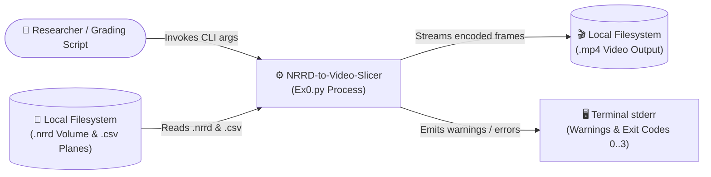
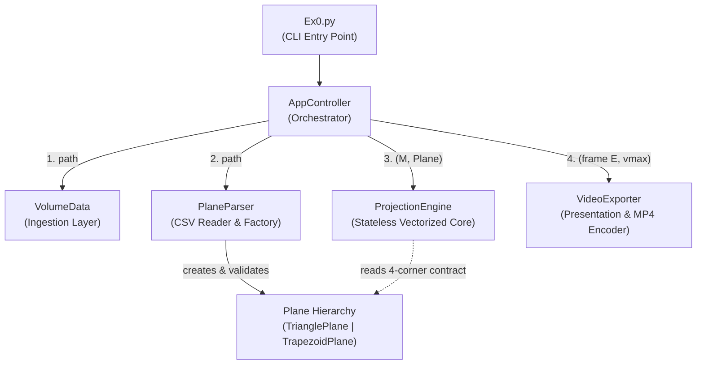
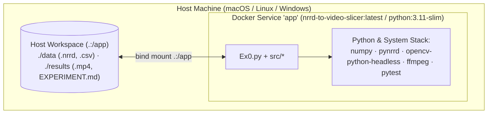

# Software Design Document (SDD)
**Project:** High-Performance 3D Volumetric Plane Projection (`Ex0.py`)

---

## 1. System Context & Boundary (C4 Level 1)

The **NRRD-to-Video-Slicer** operates as a standalone command-line container/process that reads volumetric and geometric input files from the host filesystem and writes an encoded `.mp4` video file and diagnostic logs (see [SRS.md](SRS.md)).

---

## 2. Architectural Decomposition (Components & Subsystems)

To satisfy Object-Oriented Design (OOD) and SOLID principles, the system is decomposed into **six decoupled components** inside `src/`. Only `AppController` coordinates across components; the domain and mathematical components have zero dependencies on one another and communicate strictly through immutable data contracts (§3).

### 2.1 `VolumeData` (`src/volume_data.py` — Data Ingestion Layer)
* **Role:** Dedicated 3D NRRD parser, validator, and state holder (`FR-2`, `FR-8`).
* **Design Rationale (Single Responsibility):** Isolates `pynrrd` file-reading and dtype promotion from the mathematical projection engine. Supporting a new medical format (e.g., DICOM or NIfTI) requires changes only to `VolumeData`.
* **Responsibilities:**
  * Load `.nrrd` files with Fortran index order (`index_order="F"`) so the first NRRD axis maps directly to $x$ in `M[x, y, z]`.
  * Validate 3D shape ($1 \le sx, sy, sz < 2^{10}$) and unsigned integer dtypes (`uint8`, `uint16`, `uint32`), promoting non-negative signed integer volumes (`int8`, `int16`, `int32`) to unsigned and raising `VolumeError` (exit code `2`) on any violation.
  * Lock the 3D array in contiguous memory as read-only (`flags.writeable = False`) and precompute `vmax` once at load time.

### 2.2 `Plane`, `TrianglePlane`, `TrapezoidPlane` (`src/plane.py` — Geometry Layer)
* **Role:** Immutable value objects representing one 2D slicing region in 3D space (`FR-4`, `FR-5`).
* **Design Rationale (Open/Closed Principle & Polymorphism):** `Plane` is an abstract base class exposing a unified **four-corner interface** (`top_left`, `top_right`, `bottom_left`, `bottom_right`) plus `height`, `width`, and `validate()`. Because a triangle is simply a trapezoid whose top base has zero length (`top_left == top_right == a`), `ProjectionEngine` executes a single unified algorithm without `if triangle / else trapezoid` branching.

### 2.3 `PlaneParser` (`src/plane_parser.py` — Trajectory Reader & Factory)
* **Role:** Parses the 13-column `.csv` file into an ordered list of validated `Plane` instances (`FR-3`, `FR-4`).
* **Design Rationale (Decoupling):** Separates CSV text parsing from geometric math.
* **Responsibilities:**
  * Skip blank lines and an optional non-numeric header row while preserving 1-based file line numbers for error reporting.
  * Instantiate `TrianglePlane` (when Col 1 is `3`) or `TrapezoidPlane` (when Col 1 is `4`), invoke `plane.validate()` on every row, collect $1\%\text{–}10\%$ warnings, and abort immediately with `PlaneError` on any structural error or $>10\%$ deviation before any frame is rendered.

### 2.4 `ProjectionEngine` (`src/projection_engine.py` — Algorithmic Core)
* **Role:** Stateless mathematical engine that computes 2D cross-sectional slices from `(M, Plane)` (`FR-5`, `FR-6`, `NFR-1`).
* **Design Rationale (Isolated Testability):** Accepts any in-memory 3D `numpy.ndarray` and `Plane` object without touching the filesystem or video codecs.

### 2.5 `VideoExporter` (`src/video_exporter.py` — Presentation Layer)
* **Role:** Context-managed media encoder that normalizes, pads, and writes 2D matrices into an `.mp4` stream (`FR-7`, `FR-8`, `FR-9`).
* **Design Rationale (Resource Safety):** Uses Python's context manager protocol (`__enter__` / `__exit__`) to guarantee that OpenCV `VideoWriter` handles are always released and partial files are unlinked if an exception occurs mid-stream.

### 2.6 `AppController` (`src/app_controller.py` — Execution Orchestrator)
* **Role:** Top-level coordinator that wires the components together and centralizes CLI exception-to-exit-code translation (`FR-1`, `NFR-2`, `NFR-3`).

### 2.7 Requirement-to-Component Allocation (PDR Exit Criterion)
| Component | Allocated SRS Requirements |
|---|---|
| `AppController` (`Ex0.py`, `src/app_controller.py`) | `FR-1`, `FR-7` (canvas sizing), `NFR-2` (frame streaming), `NFR-3` (exit codes) |
| `VolumeData` (`src/volume_data.py`) | `FR-2`, `FR-8` (`vmax` precomputation), `NFR-2` (single volume allocation) |
| `Plane` Hierarchy (`src/plane.py`) | `FR-4` (isosceles & coplanarity math), `FR-5` (4-corner geometry & $(N,W)$ dimensions) |
| `PlaneParser` (`src/plane_parser.py`) | `FR-3` (13-column CSV parsing), `FR-4` (up-front trajectory validation) |
| `ProjectionEngine` (`src/projection_engine.py`) | `FR-5` (vectorized scanline projection), `FR-6` (out-of-volume masking), `NFR-1` (FPS) |
| `VideoExporter` (`src/video_exporter.py`) | `FR-7` (centered black padding), `FR-8` (`uint8` scaling), `FR-9` (30 FPS `mp4v` export) |
| `SlicerError` Hierarchy (`src/exceptions.py`) | `NFR-3`, `NFR-4` (structured domain error propagation) |

---

## 3. Component Interfaces & UML Class Diagram

All inter-module communication occurs strictly through four immutable/contiguous contracts (detailed in [EDD.md](EDD.md)):
1. **`VolumeData.matrix` (`M`):** Read-only 3D `np.ndarray` (`uint8`/`uint16`/`uint32`) + scalar `vmax: int`.
2. **`Plane` Value Objects:** Frozen dataclasses exposing `top_left`, `top_right`, `bottom_left`, `bottom_right` (`shape (3,)`, `float64`), `height: int`, `width: int`, and `validate() -> list[str]`.
3. **Projected Slice (`E`):** 2D `np.ndarray` of shape `(height, width)` returned by `ProjectionEngine.project(M, plane)` and consumed immediately by `VideoExporter.write_frame(E)`.
4. **`SlicerError` Hierarchy:** Domain exceptions carrying deterministic `exit_code` attributes (`1`, `2`, `3`).

---

## 4. Deployment View

The system supports both native host execution (Python 3.10+ virtual environment) and reproducible containerized execution via [`Dockerfile`](../Dockerfile) (`python:3.11-slim` + `ffmpeg`) and [`docker-compose.yml`](../docker-compose.yml) (service `app`, mounting `.` to `/app`).

---

## 5. Architectural Rationale & Alternatives Considered (ADRs)

### ADR-01: Vectorized `NumPy` Broadcasting vs. Python Loops vs. Numba/Cython
* **Context:** A $500 \times 500$ frame requires $250,000$ 3D coordinate calculations and voxel lookups per slice. Pure Python nested `for` loops execute at $\sim 0.3\text{–}1.5\text{ FPS}$, failing `NFR-1` ($\ge 30\text{ FPS}$ mandatory, $\ge 100\text{ FPS}$ target).
* **Alternatives Considered:**
  1. *Pure Python nested scanline loops:* Simple, but $\sim 100\times$ too slow.
  2. *Numba JIT / Cython C-extensions:* High speed, but adds compiler/LLVM toolchain dependencies and warm-up compilation latency that complicate portability (`NFR-5`).
  3. *Pure `NumPy` 2D array broadcasting & masked fancy indexing (Chosen):* Computes row vectors `(N, 3)` and column offsets `(1, W)` via C-level contiguous array broadcasting.
* **Decision:** Chosen Option 3 (`NumPy` broadcasting). It requires zero external compilers, is 100% portable (`NFR-5`), and achieves **435.3 FPS** on a $500^3$ volume ([../results/EXPERIMENT.md](../results/EXPERIMENT.md)).

### ADR-02: Unified Four-Corner `Plane` Polymorphism vs. Conditional Branching
* **Context:** The system must project both 3-point isosceles triangles and 4-point isosceles trapezoids (`FR-3`, `FR-5`).
* **Alternatives Considered:**
  1. *Separate `project_triangle()` and `project_trapezoid()` methods in `ProjectionEngine`:* Duplicates scanline interpolation, boundary masking, and rounding code.
  2. *Unified 4-corner `Plane` abstraction where `TrianglePlane` sets `top_left = top_right = a` (Chosen):* Mathematically, a triangle is a degenerate trapezoid with top base length $0$.
* **Decision:** Chosen Option 2. `ProjectionEngine` has a single code path for all plane shapes.

### ADR-03: Up-Front Full CSV Validation & Two-Pass Canvas Sizing vs. Single-Pass Streaming
* **Context:** `FR-4` requires aborting without creating a video if any CSV row is invalid, and `FR-7` requires all frames in a video to share the maximum dimensions $(H_{\max}, W_{\max})$ across all planes in the CSV.
* **Decision:** Parse and validate all `Plane` objects up front in Phase 1 (lightweight metadata: a few hundred bytes per row), compute $(H_{\max}, W_{\max})$ from their geometry, and then stream the heavy 2D pixel matrices ($E$) one at a time in Phase 2 (`NFR-2`).

### ADR-04: Global Volume `vmax` Normalization vs. Per-Frame Min-Max Scaling
* **Context:** 16-bit and 32-bit medical volumes must be mapped to 8-bit grayscale `[0, 255]` (`FR-8`).
* **Decision:** Scale every frame by the global volume maximum $v_{\max}$ computed once at load time (`VolumeData.vmax`). Per-frame min-max scaling would cause artificial brightness flickering across adjacent video frames when slicing through dark vs. bright anatomical regions.
