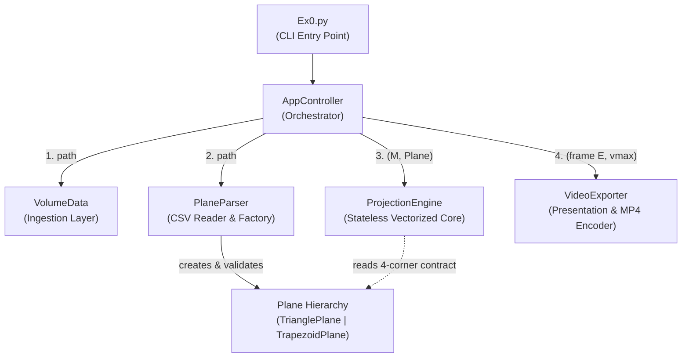
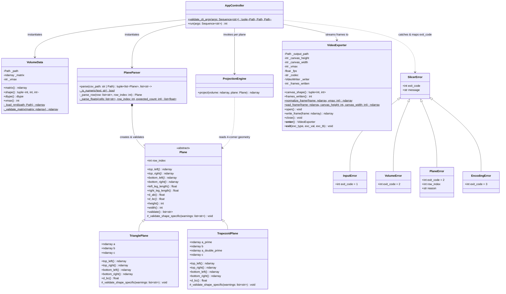
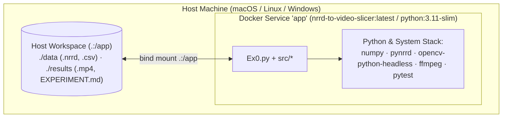

# Software Design Document (SDD)
**Project:** High-Performance 3D Volumetric Plane Projection (`Ex0.py`)

---

## 1. System Context & Boundary (C4 Level 1)

> **Big Picture:** This program takes a **3D scan** (`.nrrd`, such as an MRI) and a **list of 2D slicing shapes** (`.csv`, triangles or trapezoids floating in 3D space), cuts a 2D cross-section out of the 3D scan for each shape, and stitches those slices into an **`.mp4` video**—similar to sweeping an ultrasound probe through a 3D volume.

**End-to-End Pipeline Flow:**
`CLI Args` → `VolumeData` + `PlaneParser` → `ProjectionEngine` (per CSV row) → `VideoExporter` → `.mp4`

The **NRRD-to-Video-Slicer** runs as a standalone command-line process that reads `.nrrd` and `.csv` files from disk, writes an encoded `.mp4` video, and reports any warnings or errors to `stderr` with deterministic exit codes (`0..3`, see [SRS.md](SRS.md)).

---

## 2. Architectural Decomposition (Components & Subsystems)

To keep the codebase clean, modular, and easy to test (following Object-Oriented Design and SOLID principles), the program is split into **six independent components** inside `src/`. Only `AppController` talks to all of them—none of the other components depend on each other directly; they only pass simple, read-only data structures (§3).

### 2.1 `VolumeData` (`src/volume_data.py` — Data Ingestion Layer)
* **What it does:** Loads the `.nrrd` 3D scan into memory as a 3D voxel grid `M[x, y, z]`, checks that its size ($1 \le sx, sy, sz < 1024$) and integer data types (`uint8`, `uint16`, `uint32`, or non-negative signed integers) are valid, locks the array as read-only, and finds `vmax` (the brightest voxel in the entire scan) (`FR-2`, `FR-8`).
* **Inputs → Outputs:** Path to `.nrrd` file → Read-only 3D NumPy array `M` + global max brightness `vmax` (or raises `VolumeError`, exit code `2`).
* **Why it's separate (Single Responsibility):** Keeps file-format details (`pynrrd`) out of the math engine. Supporting a new scan format later (like DICOM or NIfTI) only requires changing `VolumeData`.

### 2.2 `Plane`, `TrianglePlane`, `TrapezoidPlane` (`src/plane.py` — Geometry Layer)
* **What it does:** Represents a single 2D slicing shape in 3D space (either a 3-point triangle or a 4-point trapezoid), calculates its output pixel `height` and `width`, and checks that its geometry is valid (non-zero size, equal-length legs, and flat coplanar points) (`FR-4`, `FR-5`).
* **Inputs → Outputs:** 3 or 4 3D point coordinates → Frozen `Plane` object exposing four corners (`top_left`, `top_right`, `bottom_left`, `bottom_right`), pixel dimensions `(height, width)`, and `validate()` warnings.
* **Why it's separate (Polymorphism / Open-Closed):** A triangle is treated as a trapezoid whose top edge has shrunk to a single point (`top_left == top_right == a`). Because every `Plane` exposes the same 4-corner interface, `ProjectionEngine` runs one clean formula for all shapes without `if triangle / else trapezoid` branches.

### 2.3 `PlaneParser` (`src/plane_parser.py` — Trajectory Reader & Factory)
* **What it does:** Reads the 13-column `.csv` file line by line, skips blank lines and an optional text header, builds the right `TrianglePlane` (`3` points) or `TrapezoidPlane` (`4` points) for each row, and validates every row *before* any video frame is rendered (`FR-3`, `FR-4`).
* **Inputs → Outputs:** Path to `.csv` file → `(planes, warnings)` tuple containing the ordered list of `Plane` objects and any $1\%\text{–}10\%$ tolerance warning messages (or aborts with `PlaneError`, exit code `2`).
* **Why it's separate (Decoupling):** Separates CSV text parsing from 3D geometry math. If the input format changed from CSV to JSON, only `PlaneParser` would change.

### 2.4 `ProjectionEngine` (`src/projection_engine.py` — Algorithmic Core)
* **What it does:** Takes the 3D scan `M` and one `Plane`, calculates where every pixel of the 2D slice lands in 3D space using fast NumPy array math (no Python loops), and samples the nearest voxel intensities (`FR-5`, `FR-6`, `NFR-1`). Pixels outside the shape or outside the 3D volume are set to `0` (black).
* **Inputs → Outputs:** `(volume M, plane P)` → 2D NumPy slice array `E` of shape `(plane.height, plane.width)`.
* **Why it's separate (Isolated Testability):** Completely stateless—it knows nothing about files, CSVs, or MP4 videos, making it trivial to unit-test and benchmark in memory.

### 2.5 `VideoExporter` (`src/video_exporter.py` — Presentation Layer)
* **What it does:** Converts raw 2D slices into an `.mp4` video at 30 FPS (`FR-7`, `FR-8`, `FR-9`). For each slice, it scales 16/32-bit brightness down to 8-bit (`0..255`) using `vmax`, centers the slice on a uniform black background of size `(H_max, W_max)` so all frames share the same resolution, and writes it to OpenCV's `mp4v` encoder.
* **Inputs → Outputs:** Output `.mp4` path, `(H_max, W_max)`, `vmax`, and streamed 2D `frame` arrays → Saved `.mp4` video file on disk (or raises `EncodingError`, exit code `3`).
* **Why it's separate (Resource Safety):** Uses Python's `with` context manager (`__enter__` / `__exit__`) so the video file handle is always closed cleanly and broken partial `.mp4` files are automatically deleted if an error happens mid-run.

### 2.6 `AppController` (`src/app_controller.py` — Execution Orchestrator)
* **What it does:** Runs the entire pipeline from start to finish: checks CLI arguments, loads `VolumeData`, parses `Plane`s, prints warnings, finds the largest frame size `(H_max, W_max)`, loops over every plane (`project` → `write_frame`), and translates any `SlicerError` into its required CLI exit code (`FR-1`, `NFR-2`, `NFR-3`).
* **Inputs → Outputs:** CLI argument strings `["file.nrrd", "file.csv", "file.mp4"]` → Integer exit code (`0`, `1`, `2`, or `3`).
* **Why it's separate (Centralized Control):** Keeps the high-level workflow readable in one place while letting lower-level modules raise clean Python exceptions instead of calling `sys.exit()`.

### 2.7 Requirement-to-Component Allocation (PDR Exit Criterion)
| Component | Allocated SRS Requirements |
|---|---|
| `AppController` (`Ex0.py`, `src/app_controller.py`) | `FR-1`, `FR-7` (canvas sizing), `NFR-2` (frame streaming), `NFR-3` (exit codes) |
| `VolumeData` (`src/volume_data.py`) | `FR-2`, `FR-8` (`vmax` precomputation), `NFR-2` (single volume allocation) |
| `Plane` Hierarchy (`src/plane.py`) | `FR-4` (isosceles & coplanarity math), `FR-5` (4-corner geometry & $(N,W)$ dimensions) |
| `PlaneParser` (`src/plane_parser.py`) | `FR-3` (13-column CSV parsing), `FR-4` (up-front trajectory validation) |
| `ProjectionEngine` (`src/projection_engine.py`) | `FR-5` (vectorized scanline projection), `FR-6` (out-of-volume masking), `NFR-1` (FPS) |
| `VideoExporter` (`src/video_exporter.py`) | `FR-7` (centered black padding), `FR-8` (`uint8` scaling), `FR-9` (30 FPS `mp4v` export) |
| `SlicerError` Hierarchy (`src/exceptions.py`) | `NFR-3`, `NFR-4` (structured domain error propagation) |

---

## 3. Component Interfaces & UML Class Diagram

Components pass data to each other using **four simple, strict contracts** (detailed further in [EDD.md](EDD.md)):
1. **3D Volume (`VolumeData.matrix` / `M`):** A read-only 3D NumPy array (`uint8`, `uint16`, or `uint32`) indexed as `M[x, y, z]`, paired with `vmax: int` (its brightest value).
2. **Slicing Shape (`Plane`):** A frozen, read-only object providing 4 corner vectors (`top_left`, `top_right`, `bottom_left`, `bottom_right`), integer pixel dimensions (`height`, `width`), and `validate() -> list[str]`.
3. **2D Slice (`E`):** A 2D NumPy array of shape `(height, width)` output by `ProjectionEngine.project(M, plane)` and immediately handed to `VideoExporter.write_frame(E)` (then freed from memory).
4. **Custom Errors (`SlicerError` subclasses):** Exceptions carrying an `.exit_code` (`1` = CLI/file issue, `2` = bad NRRD/CSV data, `3` = video encoding issue) caught by `AppController`.

---

## 4. Deployment View

The program runs identically either directly on your machine (Python 3.10+ virtual environment) or inside a locked Docker container via [`Dockerfile`](../Dockerfile) (`python:3.11-slim` + `ffmpeg`) and [`docker-compose.yml`](../docker-compose.yml) (mounting the project folder to `/app`).

---

## 5. Architectural Rationale & Alternatives Considered (ADRs)

### ADR-01: Vectorized `NumPy` Broadcasting vs. Python Loops vs. Numba/Cython
* **Problem:** A single $500 \times 500$ slice requires $250,000$ 3D coordinate calculations and voxel lookups. Nested Python `for` loops only run at $\sim 0.3\text{–}1.5\text{ FPS}$, far below the $\ge 30\text{ FPS}$ requirement (`NFR-1`).
* **Options:**
  1. *Nested Python `for` loops:* Easy to write, but $\sim 100\times$ too slow.
  2. *Numba JIT / Cython:* Fast, but adds heavy C/LLVM compiler dependencies and startup warm-up delays (`NFR-5`).
  3. *Pure `NumPy` 2D broadcasting & masked indexing (Chosen):* Pushes all pixel math into fast C-level array operations with zero Python loops.
* **Why Chosen:** Needs no extra compilers, runs everywhere (`NFR-5`), and reaches **435.3 FPS** on a $500^3$ scan ([../results/EXPERIMENT.md](../results/EXPERIMENT.md)).

### ADR-02: Unified Four-Corner `Plane` Polymorphism vs. `if/else` Branching
* **Problem:** The engine must slice both 3-point triangles and 4-point trapezoids (`FR-3`, `FR-5`).
* **Options:**
  1. *Separate `project_triangle()` and `project_trapezoid()` functions:* Duplicates almost identical scanline, centering, and boundary code.
  2. *Unified 4-corner `Plane` interface where `TrianglePlane` sets `top_left = top_right = a` (Chosen):* Geometrically, a triangle is just a trapezoid whose top edge has length $0$.
* **Why Chosen:** `ProjectionEngine` only needs **one** algorithm for both shapes, cutting code and bugs in half.

### ADR-03: Validate All CSV Rows First, Stream Pixels One Frame at a Time
* **Problem:** We must abort without creating any `.mp4` file if *any* CSV row is bad (`FR-4`), and we need to know the largest frame size $(H_{\max}, W_{\max})$ across the whole CSV before opening the video stream (`FR-7`)—without running out of RAM on long videos (`NFR-2`).
* **Why Chosen:** Reading and validating all `Plane` objects first in Phase 1 uses almost zero memory (just a few numbers per row) and immediately gives us $(H_{\max}, W_{\max})$. Then Phase 2 generates and writes the heavy 2D pixel arrays one frame at a time, freeing each frame immediately (`O(1)` memory).

### ADR-04: Global Volume `vmax` Brightness Scaling vs. Per-Frame Scaling
* **Problem:** 16-bit and 32-bit scans hold values much larger than `255`, whereas `.mp4` video requires 8-bit pixels (`0..255`, `FR-8`).
* **Why Chosen:** Every frame is scaled by the single brightest voxel in the entire 3D scan (`VolumeData.vmax`), computed once at load time. Scaling each frame by its own local max would make dark empty slices suddenly flash bright gray, causing distracting brightness flickering in the video.
