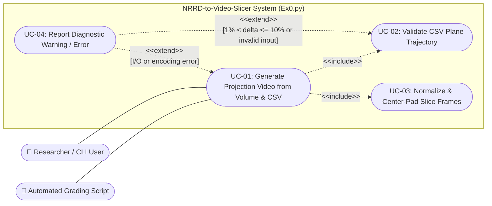
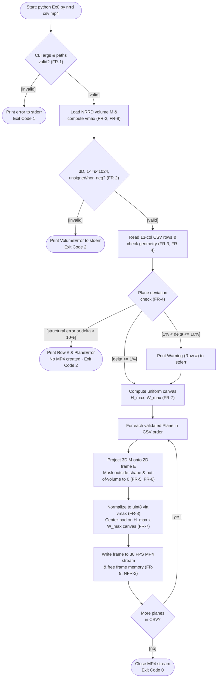

# Software Requirements Specification (SRS)
**Project:** High-Performance 3D Volumetric Plane Projection (`Ex0.py`)

---

## 1. Introduction

### 1.1 Purpose
This Software Requirements Specification (SRS) defines the functional requirements, external interfaces, non-functional quality attributes, and user-level use cases for the **NRRD-to-Video-Slicer** (`Ex0.py`). It serves as the contract between stakeholders, developers, and testers for verifying what the system must do before architectural design ([SDD.md](SDD.md)), component engineering ([EDD.md](EDD.md)), and formal testing ([STP.md](STP.md)).

### 1.2 Scope & Boundaries
The system is a command-line batch transformation utility invoked via:
```bash
python Ex0.py <file.nrrd> <file.csv> <file.mp4>
```
1. It ingests a 3D volumetric raster (`.nrrd`),
2. reads an ordered list of 3-point or 4-point slicing planes from a `.csv` file,
3. projects each slicing plane (isosceles triangle or isosceles trapezoid) onto a 2D discrete grayscale matrix, and
4. encodes all projected slices in CSV order as frames of an `.mp4` video.

**In Scope:**
* Validating CLI arguments, file extensions, and path permissions.
* Loading 3D `.nrrd` volumes and validating dimensions ($1 \le sx, sy, sz < 2^{10}$) and unsigned integer voxel types (`uint8`, `uint16`, `uint32`, plus non-negative signed integer promotion).
* Parsing and validating 13-column `.csv` plane trajectory files (3-point triangles and 4-point trapezoids) with configurable silent/warning/abort geometric tolerances.
* Nearest-neighbor 3D-to-2D plane projection with zero-masking for out-of-volume and outside-shape pixels.
* Global volume brightness normalization to 8-bit grayscale and centered black-canvas padding into a 30 FPS `.mp4` stream.

**Out of Scope:**
* Interactive Graphical User Interfaces (GUI) or real-time 3D viewport controls.
* Medical diagnostic analysis or database persistence.
* Physical/world coordinate (RAS/LPS) affine transformations (all coordinates are in voxel index space).
* Interpolation schemes other than nearest-neighbor rounding.
* Polygon shapes other than isosceles triangles and isosceles trapezoids.

### 1.3 Definitions, Acronyms & Notation
| Term | Meaning |
|---|---|
| **$M$** | The 3D volumetric raster matrix of dimensions $sx \times sy \times sz$, indexed as `M[x][y][z]`. |
| **Voxel Space** | Discrete 3D index space where $0 \le x < sx$, $0 \le y < sy$, $0 \le z < sz$. All CSV coordinates are expressed in this space. |
| **Plane ($P$)** | A 2D slicing region in 3D space: either an isosceles triangle $(a, b, c)$ or an isosceles trapezoid $(a', b, a'', c)$ with legs $a' \to b$ and $a'' \to c$. |
| **Sample Point ($p$)** | A continuous 3D point on plane $P$ whose rounded integer coordinates index into $M$. |
| **$E$** | The 2D projected output matrix (single unpadded slice frame) of height $N$ and width $W$. |
| **$D_{ab}$** | Leg length: $dist(a,b) = dist(a,c)$ for a triangle; $dist(a',b) = dist(a'',c)$ for a trapezoid. Determines frame height $N = \text{round}(D_{ab})$ (using the longer leg if slightly unequal). |
| **$D_{bc}$** | Base length: $dist(b,c)$ for a triangle, or $\max(dist(a',a''), dist(b,c))$ for a trapezoid. Determines frame width $W = \text{round}(D_{bc})$. |
| **Scanline** | One horizontal row $y \in [0, N-1]$ of $E$, sampled along the segment $a_1(y) \to a_2(y)$ connecting the two legs. |
| **Out-of-Volume** | A sample point $p$ whose rounded coordinates fall outside $[0, sx-1] \times [0, sy-1] \times [0, sz-1]$; assigned intensity $v = 0$. |
| **$v_{\max}$** | Global maximum voxel value across the entire 3D matrix $M$, used for 8-bit normalization. |

### 1.4 References
* Course Assignment Specification: *Intro2SE Ex1 — Algorithm: Implementing a plane projection of 3D volume* (Pages 1–3, including Page 2 Algorithm & Page 3 Q&A).
* 3D Slicer NRRD Format Specification ([teem.sourceforge.net/nrrd](https://teem.sourceforge.net/nrrd/)).
* Companion Project Documents: [SDD.md](SDD.md) (Architecture), [EDD.md](EDD.md) (Detailed Algorithm & Component Design), [STP.md](STP.md) (Test Plan & Descriptions), [../results/EXPERIMENT.md](../results/EXPERIMENT.md) (Benchmark Report).

---

## 2. Overall Description

### 2.1 Product Perspective
`Ex0.py` is a self-contained, headless command-line application that operates as an automated batch data-transformation pipeline. It takes static files from the local filesystem (`.nrrd` and `.csv`) and produces a standard `.mp4` video artifact without requiring network access, external services, or interactive user prompts.

### 2.2 User Classes & Actors
| Actor | Role & Interaction Pattern |
|---|---|
| **Researcher / Student User** | Invokes `Ex0.py` from a terminal to visualize oblique and axis-aligned cross-sectional sweeps through 3D volumetric scans. Expects clear diagnostic messages on bad inputs and smooth MP4 playback. |
| **Automated Grading / CI Script** | Invokes `Ex0.py` programmatically via subprocess calls on test fixtures, asserting deterministic exit codes (`0, 1, 2, 3`), exact frame counts, canvas dimensions, and $\ge 30\text{ FPS}$ runtime throughput. |

### 2.3 Operating Environment
* **Operating Systems:** macOS, Linux, and Windows (including Linux Docker containers on `aarch64` and `x86_64`).
* **Runtime:** Python 3.10 or newer.
* **Hardware Baseline:** Standard consumer CPU/SoC (e.g., Apple M-series or modern x86_64 processor) with sufficient RAM to hold a single $500^3$ volume ($\sim 125\text{ MB}$ for `uint8`, up to $500\text{ MB}$ for `uint32`).

### 2.4 Design & Implementation Constraints
* **CLI Signature Constraint:** Must strictly follow `python Ex0.py <file.nrrd> <file.csv> <file.mp4>` (Assignment Ex1 To-Do #7).
* **Grid & Bit-Depth Constraint:** Volume axes must satisfy $1 \le sx, sy, sz < 2^{10}$ with unsigned integer voxel values of 8, 16, or 32 bits (Assignment Ex1 Problem Definition). Non-negative signed integer NRRD volumes (such as 3D Slicer's 16-bit `short` `MRHead_1.nrrd`) are promoted to unsigned integers.
* **Reconciliation of Assignment Page 2/3 Q&A with Classroom CSV Data:**
  * *Trapezoid Point Ordering:* While Ex1 Page 3 Q&A writes the 4 points in prose as $(a_1, a_2, b, c)$, Page 2 states that a trapezoid is presented by *"two vectors on the same plane with the same length: $a' \to b$ and $a'' \to c$"*, and the provided classroom [`data/sample_planes.csv`](../data/sample_planes.csv) stores 4-point rows in the column order $(a', b, a'', c)$ (e.g., Row 2: `(200,0,0), (200,0,500), (200,400,0), (200,400,500)`). The system therefore follows the actual CSV schema $(a', b, a'', c)$, and sets $D_{bc} = \max(dist(a', a''), dist(b, c))$ so trapezoids work seamlessly even when $dist(a', a'') > dist(b, c)$.
  * *Isosceles Tolerance (`EPS` vs. Relative $\delta$):* Ex1 Page 3 Q&A mentions $|dist(a,b) - dist(a,c)| < \text{EPS}$ ($\text{EPS}=0.001$), whereas Row 3 of the classroom [`data/sample_planes.csv`](../data/sample_planes.csv) (`3,200,200,-30,-50,200,400,400,250,400,,,`) has leg lengths $497.39$ and $476.86$ ($\delta = 4.12\%$). To support both strict geometric inputs and the classroom dataset without silent distortion, `FR-4` enforces a three-tier relative tolerance: $\delta \le 1\%$ (accepted silently, covering $\text{EPS}=0.001$), $1\% < \delta \le 10\%$ (projected with a diagnostic warning on `stderr`), and $\delta > 10\%$ (aborted with exit code `2`).
* **Up-Front Validation Constraint:** No partial or corrupted `.mp4` file may be written if any CSV row fails validation.

### 2.5 Assumptions & Dependencies
* All 3D coordinates in the `.csv` file are given directly in discrete voxel index space relative to $M[x][y][z]$.
* Third-party runtime libraries are restricted to standard `pip`-installable scientific/media packages (`numpy`, `pynrrd`, `opencv-python`).

---

## 3. Specific Requirements

### 3.1 External Interface Requirements
* **EIR-1 (Command-Line Interface):**
  * **Invocation:** `python Ex0.py <file.nrrd> <file.csv> <file.mp4>`
  * **Standard Output (`stdout`):** Silent during normal execution so automated scripts can parse output cleanly.
  * **Standard Error (`stderr`):** Receives non-fatal geometric warnings (`1% < delta <= 10%`) and single-line diagnostic error messages on abort.
  * **Exit Codes:** `0` (Success), `1` (CLI/file/permission error), `2` (Invalid NRRD volume or CSV plane geometry), `3` (Video encoding failure).
* **EIR-2 (Input Volume File Interface — `.nrrd`):**
  * Standard NRRD 3D raster file (`uint8`, `uint16`, `uint32`, or non-negative `int8`/`int16`/`int32`). First NRRD axis corresponds to $x$, second to $y$, third to $z$.
* **EIR-3 (Input Trajectory File Interface — `.csv`):**
  * UTF-8 comma-separated text file with exactly 13 columns per non-blank row:
    `Number of Point, x1,y1,z1, x2,y2,z2, x3,y3,z3, x4,y4,z4`
* **EIR-4 (Output Video File Interface — `.mp4`):**
  * MPEG-4 video file (`mp4v` fourcc codec) encoded at 30.0 FPS playback rate with uniform resolution $(H_{\max}, W_{\max})$.

### 3.2 Functional Requirements (FR)

*(Prioritized using MoSCoW: **Must** = Mandatory for release, **Should** = Important quality goal)*

* **FR-1 — CLI Argument & Path Validation [Priority: Must]:**
  The system shall accept exactly three positional command-line arguments (`<file.nrrd>`, `<file.csv>`, `<file.mp4>`) and verify before loading data that both input files exist, all three file extensions match `.nrrd`, `.csv`, and `.mp4` (case-insensitive), and the output path's directory exists and is writable. On any violation, the system shall print a clear diagnostic message to `stderr` and exit with code `1`.
* **FR-2 — Volumetric Data Ingestion & Validation [Priority: Must]:**
  The system shall parse `.nrrd` files into a 3D matrix $M$ indexed as `M[x][y][z]` with dimensions satisfying $1 \le sx, sy, sz < 2^{10}$ and unsigned integer data types (`uint8`, `uint16`, `uint32`). Signed integer NRRD files (`int8`, `int16`, `int32`) whose minimum voxel value is $\ge 0$ shall be promoted to their corresponding unsigned type. Any non-3D array, dimension $\ge 2^{10}$, negative voxel value, or unsupported data type (e.g., floating-point) shall be rejected with a diagnostic message and exit code `2`.
* **FR-3 — CSV Trajectory Parsing [Priority: Must]:**
  The system shall parse the `.csv` file in row order, ignoring blank lines and skipping the first non-blank line if its first cell is non-numeric (header):
  * Each data row shall contain 13 columns where Column 1 specifies the point count: `3` (isosceles triangle) or `4` (isosceles trapezoid). Triangle and trapezoid rows may be mixed within the same file.
  * For a `3`-point row, columns 2–10 specify $a, b, c$ and columns 11–13 must be empty.
  * For a `4`-point row, columns 2–13 specify $a', b, a'', c$ such that the two legs are $a' \to b$ and $a'' \to c$.
* **FR-4 — Up-Front Plane Geometric Validation [Priority: Must]:**
  The system shall validate all CSV rows before rendering any frame:
  * **Structural errors (immediate abort):** Point count not in `{3, 4}`, mismatch between point count and populated coordinate cells, missing/non-numeric coordinates, collinear points with zero area, or rounded plane dimensions $N < 1$ or $W < 1$ pixel.
  * **Isosceles leg tolerance:** Given leg difference $\delta = |L_1 - L_2| / \max(L_1, L_2)$:
    * $\delta \le 1\%$: accepted silently.
    * $1\% < \delta \le 10\%$: accepted, and a warning naming the 1-based row number and $\delta$ is printed to `stderr`.
    * $\delta > 10\%$: rejected (run aborts).
  * **Trapezoid coplanarity tolerance:** The orthogonal distance of point $c$ from the plane of $(a', b, a'')$, divided by $D_{ab}$, shall obey the same $\le 1\%$ silent, $1\%\text{–}10\%$ warning, and $> 10\%$ abort rules.
  * On any abort, the system shall report the 1-based CSV row number and reason, exit with code `2`, and create no `.mp4` file.
* **FR-5 — 3D-to-2D Plane Projection [Priority: Must]:**
  For each validated plane $P$, the system shall construct a 2D output matrix $E$ of height $N = \text{round}(D_{ab})$ rows and width $W = \text{round}(D_{bc})$ columns (`E[row][col]`):
  * Each row $y \in [0, N-1]$ shall step fractionally along both legs ($t = (y+1)/N$) to determine scanline endpoints $a_1(y)$ and $a_2(y)$, sampling $M$ along $a_1(y) \to a_2(y)$ at nearest-neighbor (rounded) integer voxel coordinates and centering the scanline horizontally within width $W$.
  * Pixels of $E$ lying outside the triangle/trapezoid scanline span shall be assigned intensity `0`.
* **FR-6 — Out-of-Volume Boundary Handling [Priority: Must]:**
  Any sampled 3D point whose rounded integer coordinates fall outside $[0, sx-1] \times [0, sy-1] \times [0, sz-1]$ shall be assigned a voxel value of $v = 0$ without raising runtime exceptions.
* **FR-7 — Uniform Video Canvas Padding [Priority: Must]:**
  All frames in a single output video shall share a uniform canvas resolution $(H_{\max}, W_{\max})$, where $H_{\max} = \max_i N_i$ and $W_{\max} = \max_i W_i$ across all validated planes in the CSV. Any frame smaller than $(H_{\max}, W_{\max})$ shall be centered on the canvas with black (`0`) border padding.
* **FR-8 — Global Bit-Depth Normalization [Priority: Must]:**
  `uint8` volumes shall retain their native $[0, 255]$ values. For `uint16` and `uint32` volumes, every projected frame shall be normalized to `uint8` $[0, 255]$ using a single global factor $v_8 = \text{round}(v \times 255 / v_{\max})$, where $v_{\max}$ is the maximum intensity of the entire volume $M$ (an all-zero volume produces all-zero frames).
* **FR-9 — MP4 Video Encoding [Priority: Must]:**
  The system shall encode the normalized, padded 8-bit grayscale frames in CSV row order into a valid `.mp4` video stream at 30.0 FPS using the `mp4v` codec, overwriting the target file if it already exists. If encoding fails, the system shall clean up any partial output file and exit with code `3`.

### 3.3 Non-Functional Requirements (NFR)
* **NFR-1 — Projection Throughput (Performance) [Priority: Must]:**
  On a $500 \times 500 \times 500$ `uint8` volume with $500 \times 500$ slicing planes, pure projection time (excluding disk I/O and video encoding) shall not exceed $33.3\text{ ms}$ per frame (**$\ge 30\text{ FPS}$ mandatory floor**), with a target of $\le 10.0\text{ ms}$ per frame (**$\ge 100\text{ FPS}$ target**), measured as the median of at least 3 runs following 1 warm-up pass.
* **NFR-2 — Constant Frame Memory Footprint [Priority: Must]:**
  The 3D matrix $M$ shall be loaded into RAM once. Projected 2D frames ($E$) shall be streamed directly to the video encoder and released immediately after writing, maintaining $O(1)$ per-frame memory overhead regardless of CSV length.
* **NFR-3 — Robustness & Fault Tolerance [Priority: Must]:**
  The system shall never expose unhandled Python tracebacks or division-by-zero crashes on malformed files or degenerate geometry, exiting deterministically with codes `0`, `1`, `2`, or `3`.
* **NFR-4 — Modularity & Verifiability [Priority: Should]:**
  Every functional and non-functional requirement (`FR-1..FR-9`, `NFR-1..NFR-5`) shall be independently verifiable via automated tests without requiring manual visual inspection.
* **NFR-5 — Cross-Platform Portability [Priority: Should]:**
  The system shall execute identically on Python 3.10+ across macOS, Linux, and Windows using only `numpy`, `pynrrd`, and `opencv-python`.

---

## 4. Appendices

### 4.1 Use Case Model & UML Use Case Diagram



### 4.2 Detailed Use Cases

#### `UC-01`: Generate Projection Video from Volume & CSV
* **Actor:** Researcher / CLI User (or Automated Grading Script)
* **Preconditions:** Python environment is configured; user has paths to a `.nrrd` file, a `.csv` file, and a writable output directory.
* **Main Success Flow:**
  1. Actor invokes `python Ex0.py <file.nrrd> <file.csv> <file.mp4>`.
  2. System validates CLI arguments, file existence, extensions, and output write permissions (`FR-1`).
  3. System loads the `.nrrd` volume $M$, validates dimensions and unsigned integer data type (`FR-2`), and records $v_{\max}$ (`FR-8`).
  4. System parses and validates all plane rows in `<file.csv>` (`UC-02`, `FR-3`, `FR-4`).
  5. System computes the uniform canvas dimensions $(H_{\max}, W_{\max})$ across all planes (`FR-7`) and opens the `.mp4` stream at 30 FPS (`FR-9`).
  6. For each plane in CSV order, System samples $M$ onto 2D matrix $E$ (`FR-5`, `FR-6`), normalizes and center-pads $E$ (`UC-03`, `FR-7`, `FR-8`), and writes the frame to the `.mp4` stream (`FR-9`, `NFR-2`).
  7. System closes the `.mp4` file and exits with status code `0`.
* **Alternative Flows:**
  * **2a. Invalid CLI arguments, missing input file, wrong extension, or unwritable output path:** System triggers `UC-04` (`InputError`) and exits with code `1` (`FR-1`).
  * **3a. Volume is not 3D, exceeds $1023$ on any axis, contains negative values, or uses unsupported dtype:** System triggers `UC-04` (`VolumeError`) and exits with code `2` (`FR-2`).
  * **4a. Any CSV row fails structural or $>10\%$ geometric tolerance validation:** System triggers `UC-04` (`PlaneError`), creates no `.mp4` file, and exits with code `2` (`FR-4`).
  * **6a. Video encoder fails to initialize or write a frame:** System removes any partial `.mp4` file, triggers `UC-04` (`EncodingError`), and exits with code `3` (`FR-9`).
* **Postconditions:** A valid 30 FPS `.mp4` file exists on disk containing exactly one frame per CSV data row at resolution $(H_{\max}, W_{\max})$.

#### `UC-02`: Validate CSV Plane Trajectory
* **Actor:** System (included by `UC-01`)
* **Preconditions:** Input `.csv` file exists and is readable.
* **Main Success Flow:**
  1. System reads the CSV line by line, skipping blank lines and an optional non-numeric header on the first non-blank line (`FR-3`).
  2. For each row, System verifies there are 13 columns, parses Column 1 (`3` or `4`), and extracts 3 or 4 3D coordinate triples (`FR-3`).
  3. System computes leg lengths $L_1, L_2$, base width $D_{bc}$, rounded dimensions $(N, W)$, relative leg difference $\delta$, and (for 4-point rows) relative coplanarity deviation (`FR-4`).
  4. All deviations are $\le 1\%$ and $N, W \ge 1$; System returns the ordered list of validated planes with zero warnings.
* **Alternative Flows:**
  * **3a. Deviation is between $1\%$ and $10\%$ ($1\% < \delta \le 10\%$):** System accepts the plane, invokes `UC-04` to emit a warning naming the row number and percentage, and continues validation (`FR-4`).
  * **2a / 3b. Malformed row, collinear points, $N < 1$ or $W < 1$, or deviation $> 10\%$:** System aborts validation immediately via `UC-04` with the exact 1-based row number and reason (`FR-4`).
* **Postconditions:** Either all planes in the CSV are verified safe for projection (no zero-length vectors), or execution halts before video creation.

#### `UC-03`: Normalize & Center-Pad Slice Frames
* **Actor:** System (included by `UC-01`)
* **Preconditions:** Volume maximum $v_{\max}$ and global canvas size $(H_{\max}, W_{\max})$ are known; raw slice matrix $E$ of shape $(N, W)$ has been projected.
* **Main Success Flow:**
  1. If $M$ is `uint16` or `uint32`, System scales $E$ to `uint8` via $\text{round}(E \times 255 / v_{\max})$ (`FR-8`); if `uint8`, $E$ is used directly.
  2. If $(N, W) < (H_{\max}, W_{\max})$, System allocates a zeroed `uint8` canvas of shape $(H_{\max}, W_{\max})$ and copies the normalized slice into the center offset $(\lfloor(H_{\max}-N)/2\rfloor, \lfloor(W_{\max}-W)/2\rfloor)$ (`FR-7`).
  3. System passes the $(H_{\max}, W_{\max})$ frame to the MP4 encoder and releases the temporary slice buffer (`NFR-2`).
* **Alternative Flows:**
  * **1a. Volume is all zeros ($v_{\max} = 0$):** System produces an all-zero `uint8` frame without dividing by zero (`FR-8`).
* **Postconditions:** Frame written to video stream is `uint8` with exact dimensions $(H_{\max}, W_{\max})$.

#### `UC-04`: Report Diagnostic Warning / Error
* **Actor:** System (extends `UC-01` and `UC-02` under warning or error conditions)
* **Preconditions:** A geometric deviation in $(1\%, 10\%]$ or a domain error (`InputError`, `VolumeError`, `PlaneError`, `EncodingError`) has been detected.
* **Main Success Flow (Non-Fatal Geometric Warning):**
  1. `UC-02` detects a plane with $1\% < \delta \le 10\%$ (leg mismatch or trapezoid coplanarity).
  2. System formats a warning message containing the 1-based CSV row index and exact percentage deviation.
  3. System writes the warning to `stderr` while keeping `stdout` clean (`EIR-1`, `FR-4`).
  4. Control returns to `UC-01` / `UC-02` so video generation proceeds normally.
* **Alternative Flows (Fatal Domain Errors):**
  * **1a. CLI or File/Permission Error (`InputError`):** System writes `"Error: <reason>"` to `stderr` without a Python traceback and terminates the process with exit code `1` (`FR-1`, `NFR-3`).
  * **1b. Volume or CSV Validation Error (`VolumeError` / `PlaneError`):** System writes `"Error: <reason>"` (including `"Row <row_index>: ..."` for CSV errors) to `stderr`, ensures no `.mp4` file is created, and terminates with exit code `2` (`FR-2`, `FR-4`, `NFR-3`).
  * **1c. Video Encoding Failure (`EncodingError`):** System closes and unlinks any partial `.mp4` file on disk, writes `"Error: <reason>"` to `stderr`, and terminates with exit code `3` (`FR-9`, `NFR-3`).
* **Postconditions:** Actor receives a deterministic exit code (`0, 1, 2, 3`) and a human-readable diagnostic on `stderr`; no corrupted or partial `.mp4` artifact remains on disk.

### 4.3 UML Activity Diagram: Flow of `UC-01` & `UC-02`



### 4.4 Domain Data Dictionary
| Entity / Field | Domain Type | Constraints & Meaning |
|---|---|---|
| `M` | 3D Matrix (`uint8` / `uint16` / `uint32`) | Dimensions $1 \le sx, sy, sz < 1024$; voxel values $\ge 0$. |
| `Number of Point` | Integer (CSV Col 1) | Value in `{3, 4}`; selects triangle (`3`) vs. trapezoid (`4`). |
| `x1..z4` | Real numbers (CSV Cols 2–13) | Voxel-space coordinates; Cols 11–13 empty when Col 1 is `3`. |
| `delta` ($\delta$) | Ratio $\in [0, 1]$ | $|L_1 - L_2| / \max(L_1, L_2)$; $\le 0.01$ silent, $(0.01, 0.10]$ warning, $> 0.10$ abort. |
| `E` | 2D Matrix ($N \times W$) | Unpadded slice; $N = \text{round}(D_{ab}) \ge 1$, $W = \text{round}(D_{bc}) \ge 1$. |
| `Canvas Frame` | 2D Matrix ($H_{\max} \times W_{\max}$, `uint8`) | Normalized $[0, 255]$ grayscale frame centered on black (`0`) border. |

### 4.5 Requirements Traceability Matrix
| Req ID | Requirement Summary | Use Case | Design Ref ([SDD](SDD.md) / [EDD](EDD.md)) | Test Cases ([STP / STD](STP.md)) | Status |
|---|---|---|---|---|---|
| **FR-1** | CLI argument & path validation (exit code 1) | `UC-01`, `UC-04` | `SDD §2.6`, `EDD §1.4` | `TC-12`, `TC-13` | Passed |
| **FR-2** | NRRD ingestion, grid bounds & dtype validation | `UC-01`, `UC-04` | `SDD §2.1`, `EDD §1.1` | `TC-01`, `TC-02`, `TC-03` | Passed |
| **FR-3** | 13-column CSV parsing (3- & 4-point rows) | `UC-01`, `UC-02` | `SDD §2.3`, `EDD §3` | `TC-06`, `TC-07` | Passed |
| **FR-4** | Plane validation ($\le 1\%$ silent, $1\text{–}10\%$ warn, $>10\%$ abort) | `UC-02`, `UC-04` | `SDD §2.2`, `EDD §1.2` | `TC-04`, `TC-05`, `TC-07`, `TC-14` | Passed |
| **FR-5** | 3D-to-2D plane projection & outside-shape zeroing | `UC-01` | `SDD §2.4`, `EDD §2` | `TC-08`, `TC-09` | Passed |
| **FR-6** | Out-of-volume boundary masking ($v = 0$) | `UC-01` | `SDD §2.4`, `EDD §2.4` | `TC-09` | Passed |
| **FR-7** | Uniform $H_{\max} \times W_{\max}$ canvas & centered black padding | `UC-03` | `SDD §2.5`, `EDD §3` | `TC-10`, `TC-11`, `TC-12` | Passed |
| **FR-8** | Global `vmax` brightness normalization to `uint8` | `UC-03` | `SDD §2.1, §2.5`, `EDD §1.1` | `TC-01`, `TC-10` | Passed |
| **FR-9** | MP4 video export (30 FPS, `mp4v`, CSV order) | `UC-01`, `UC-04` | `SDD §2.5`, `EDD §4.1` | `TC-11`, `TC-12` | Passed |
| **NFR-1** | $\ge 30\text{ FPS}$ mandatory, $\ge 100\text{ FPS}$ target on $500^3$ | `UC-01` | `SDD §5.1`, `EDD §2.4, §6` | `TC-15` | Passed (435 FPS) |
| **NFR-2** | Single volume load & $O(1)$ frame memory streaming | `UC-01`, `UC-03` | `SDD §2.6`, `EDD §4.1, §6` | `TC-12` | Passed |
| **NFR-3** | Fault tolerance & deterministic exit codes (`0..3`) | `UC-01`, `UC-04` | `SDD §3`, `EDD §1.4, §5` | `TC-03`, `TC-05`, `TC-13`, `TC-14` | Passed |
| **NFR-4** | Decoupled module testability & full traceability | All | `SDD §2, §3`, `EDD §8` | `TC-01`–`TC-15` | Passed |
| **NFR-5** | Cross-platform Python 3.10+ portability | `UC-01` | `SDD §4` | `TC-12`, Docker CI | Passed |
